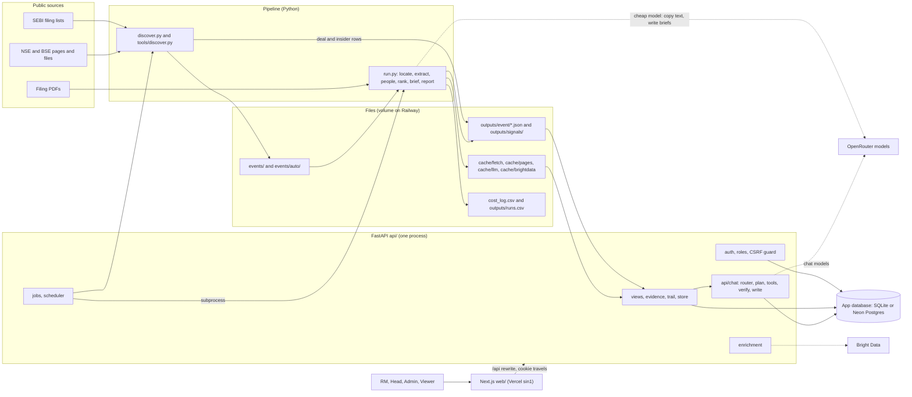
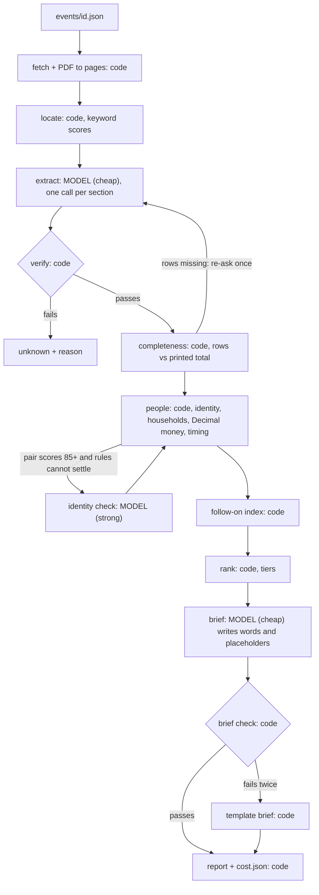
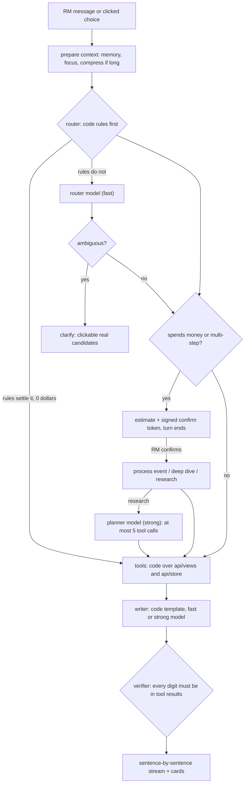
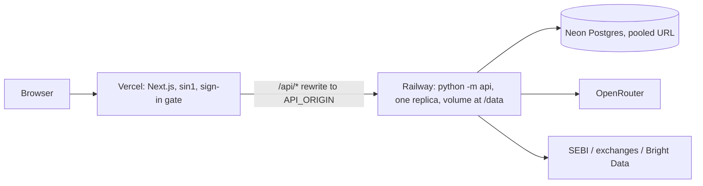

# AURELIA: engineering handover

Written 16 Nov 2026 for the engineer who takes over this repository from the zip. Branch `demo-rebuild`. Other sessions kept committing while this was written (the last one I saw was `82d7e9f`; the overnight fixes are listed at the end of section 5.7); the commits after `d9d9dbe` fix mobile overflow and the pipeline console, rework the network page and make a sale one row (see 9.2 and 3.4). Run `git log --oneline` for the real head.
Everything here was checked against the code and the files in this checkout; where a number is quoted it carries its source and date.
If a sentence here and the code disagree, **the code wins** (see section 0.2).

## Contents

0. [Read this first](#0-read-this-first)
1. [What the product is](#1-what-the-product-is)
2. [Architecture](#2-architecture)
3. [The pipeline, agent by agent](#3-the-pipeline-agent-by-agent)
4. [The control-tower chat](#4-the-control-tower-chat)
5. [Signals and discovery](#5-signals-and-discovery)
6. [Bright Data enrichment](#6-bright-data-enrichment)
7. [Data model and storage](#7-data-model-and-storage)
8. [Run it locally, and deploy it](#8-run-it-locally-and-deploy-it)
9. [Testing, cost, and what is broken](#9-testing-cost-and-what-is-broken)
10. [Why it is built this way, and a file map](#10-why-it-is-built-this-way-and-a-file-map)
- [Appendix A: environment variables](#appendix-a-environment-variables)
- [Appendix B: API route map](#appendix-b-api-route-map)

---

## 0. Read this first

### 0.1 Five things that will bite you if you skip them

1. **Rotate every key before you do anything else.** The working folder has a `.env` with a live OpenRouter key (`LLM_API_KEY`) and a live Bright Data token (`BRIGHTDATA_API_TOKEN`). `.env` is git-ignored and Docker-ignored, but **it was inside earlier zips of this folder** (an older zip of this repo, built 15 Nov, contains a `.env` with `LLM_API_KEY`). Treat both keys as exposed: create new ones, put them only in your own `.env` or the host's secret store, revoke the old ones. `docs/DEPLOYMENT.md` only tells you to rotate the OpenRouter key; **the Bright Data token needs the same treatment**. Also delete `api/state/session_secret` and `api/state/app.sqlite` from your copy (they hold a local signing secret and the demo password hashes) and let the API make fresh ones.
2. **The prime rule is a hard constraint, not a style.** *An invented number is the worst possible failure.* A model only copies text; code checks every quote against the page and does all arithmetic. A value that cannot be verified is shown as "unknown" with a reason. Any change that lets a model's digits reach an RM's screen breaks the product. Section 3.2 lists the places this is enforced; keep each one.
3. **Model calls are cached by exact prompt.** Changing a prompt string, a prompt version constant, a schema, or the model id invalidates the cache for that call site and every repeat run starts costing real money again. The shipped `cache/llm/` (1,055 files, 5.1 MB on 16 Nov 2026) is what makes reruns of the shipped events free. Bump a `*_PROMPT_VERSION` only on purpose.
4. **Check the working tree first.** At hand-over (16 Nov 2026, 04:30 IST) everything was committed. The running app keeps writing run data whenever it processes an event or the 3-hourly scheduler runs (`cost_log.csv`, `outputs/runs.csv`, `outputs/<event>/*`, `outputs/<event>/runs/`, new `cache/llm/` files), so `git status` will show those. They are data, not code: commit them as run logs.
5. **Do not trust the older prose docs for facts that changed.** Several were written before the chat, Bright Data, NSE/BSE and the admin features landed. See the next table.

### 0.2 Precedence, and the statements that are now out of date

When two sources disagree, trust them in this order: **the code and `config/*.py` docstrings** > `decision_log.md` rows 15 and 16 > the design specs in `docs/superpowers/specs/2026-11-*.md` > `api/CHAT_CONTRACT.md` and `api/CONTRACT.md` > everything else.

| Where it is said | What it says | What is true (source) |
| --- | --- | --- |
| `README.md` (How it works, Running a new event), `assumptions.md` #12, `docs/what_if.md` section 2, `whats_broken.md` section 4 | NSE and BSE are off | They are **on by default**. `EXCHANGE_SOURCES` defaults to `on` (`config/exchanges.py`, `tools/discover.py`); decision_log row 15 supersedes row 8. The legacy `nse_rss`/`bse_rss` entries in `config/sources.py` stay `enabled: False`, which is what the old docs describe. The readers that actually run are the `EXCHANGE_SOURCES` tuple in the same file, implemented in `tools/exchanges/` |
| `CLAUDE.md` rule 4, `docs/what_if.md` section 3 | "No LinkedIn" / "no web search, no LinkedIn" | LinkedIn and web search exist, through Bright Data, **on by default** for LinkedIn (`LINKEDIN_ENRICHMENT=on`). It is an owner ruling that contradicts the assignment brief. Section 6 |
| `CLAUDE.md` | Windows/PowerShell environment; "pipeline status" table with steps 3 to 8 pending; "next task: step 2d" | Obsolete. This is macOS-developed; every pipeline step is built. The file's value now is the **Hard rules** list and the SEDEMAC hand-checked facts. It also says "do not write `decision_log.md`, `assumptions.md`, `whats_broken.md` for the user: they must be in the user's own words" (rule 6): keep that |
| `README.md` | 3 demo accounts | `api/seed_users.py` seeds **5**: `admin@`, `rm@`, `viewer@`, `new.rm@` and `head@aurelia.demo`, password `demo1234`. `head@` is seeded only when not in production |
| `README.md`, `docs/DEPLOYMENT.md` | Database tables: `users`, `rm_state`, `chat_conversations`, `chat_messages` | **12 tables**: those 4, plus `assignments`, `review_decisions`, `follows`, `alert_log` (`api/db.py`), `user_prefs`, `user_book` (`api/prefs.py`), `user_brief`, `user_seen` (`api/brief.py`) |
| `README.md`, `docs/DEPLOYMENT.md` | 361 tests, "about 15 s" | `pytest --collect-only` found **911 tests** on `demo-rebuild` at hand-over (16 Nov 2026, morning); the full run is far slower than 15 s (section 9.1) |
| `README.md` | 19 events; "14 more from live discovery"; $0.46 over 2,022 model calls | `events/` plus `events/auto/` hold **38 document events** (14 IPO, 21 buyback, 3 exchange OFS) and **357 structured events** (293 block/bulk deals, 64 insider sales), counted from each file's `event_type` on 16 Nov 2026. `cost_log.csv` has 2,599 rows and about **$0.68** summed (charged where OpenRouter reported it, else our estimate; ping row excluded), of which Haiku $0.606, Sonnet $0.029, the two chat models $0.044 |
| `docs/DEPLOYMENT.md` first-boot log | "seeded {'outputs': 154, 'events': 20 ...}" | Those counts were true on 15 Nov. The repo now tracks 395 event specs and 2,734 files under `outputs/` (`git ls-files`, 16 Nov), so expect a much larger seed |
| `docs/DEPLOYMENT.md` env table | Lists no Bright Data, chat-model, budget or as-of variables | Appendix A of this file has the full list. Note `BRIGHTDATA_REQUEST_CAP` is **enforced** by the client; `BRIGHTDATA_MONTHLY_CAP` is **display only** (`/ops/health`) |
| `docs/DEPLOYMENT.md` | The Accuracy page (`/ops/accuracy`) is part of Trust & Ops | The page's **re-run** will fail in the Railway image as built: `.dockerignore` excludes `eval/` while `api/accuracy.py` imports `eval.check_people` on a re-run, and no stored result ships. See section 9.5 |

### 0.3 If you only have an hour

1. Skim sections 1 to 3 (what, how, why it is split this way).
2. Run it (section 8.1), sign in as `rm@aurelia.demo`, click a ₹ figure on a call card, and open the person's **How we found them** trail.
3. Open `outputs/sedemac_ipo/` and read `report.md`, then `extract.json` and `people.json` beside it. That is the whole pipeline in files.
4. Read `agents/verify.py`'s docstring, `agents/brief.py`'s docstring and `api/chat/verifier.py`'s docstring. They are the three guards behind the prime rule.

---

## 1. What the product is

**AURELIA** turns a public money event on the Indian market into a ranked **call list for relationship managers (RMs)** at a wealth firm. When a company lists (IPO), buys back shares, or a promoter sells through the exchange, named people receive cash or can suddenly sell shares. AURELIA reads the filings for that event and returns, per person:

- their name and role **as printed** in the filing;
- why they get money, and a **₹ figure with its working** (for example `17,300,800 × ₹271.00 = ₹468.85 crore`);
- **when** the money arrives (cash in hand, cash due, shares just unlocked, still locked in);
- **confidence**, kept separate from the amount, about whether it is the right *person*;
- a **link to the exact filing page** behind every fact, with the quote highlighted on the page image;
- a short **RM brief** (3 or 4 lines) to read before the call.

The business problem it answers (`docs/part_c.md`): a mid-sized wealth firm's RMs "hear about IPO money a month late, after a competitor has already called." The product's job is to be early, specific and trustworthy.

### 1.1 Who uses it (roles)

Roles are defined once in `api/auth.py` and the web app reads the same table from `GET /api/auth/me`.

| Role | Demo account | Can do |
| --- | --- | --- |
| `admin` | `admin@aurelia.demo` | Everything: process events, add events, run the pipeline console, Sources, Trust & Ops, health, accuracy |
| `head` (Head of RMs) | `head@aurelia.demo` | Everything an RM does, plus the **Team** dashboard, assigning people to RMs, and the **review queue**. Not `ops` or `process` |
| `rm` | `rm@aurelia.demo`, `new.rm@aurelia.demo` | View, ask, log call outcomes and notes, export, follow people; confirm chat estimates up to **$0.50** per action. `new.rm@` has not seen the setup guide yet, so the first sign-in shows it |
| `viewer` | `viewer@aurelia.demo` | Read only; $0 questions only; cannot confirm anything that spends |

Permission table (`api/auth.py`): `view` all roles; `edit_rm`, `export`, `ask` admin/head/rm; `team`, `review` admin/head; `process`, `ops` admin only.

### 1.2 The one rule everything is built around

> **Never invent a number.** A cheap model *copies* text from a few chosen pages. Code checks every quote against the page text and does all the arithmetic with `Decimal`. A value that fails a check is shown as **unknown, with the reason**, and nothing downstream is allowed to fill it.

Corollaries you will see everywhere in the code:

- "Unknown" is never zero. A missing amount shows a reason, not `₹0`.
- A computed figure links to **each of its inputs** (shares and price), not to a summary.
- Models write *words*; code writes *digits*. Where a model's text reaches the screen, a code check removes any digit that is not in the stored data (the brief, the chat answer, call scripts, the daily brief, the conversation summary).
- Dates and lock-in periods come from the **quoted rule in that event's own document**, never from memory of SEBI rules.
- No personal contact details are collected, anywhere.

### 1.3 The event types

| `event_type` | What it is | Who is paid | Documents read |
| --- | --- | --- | --- |
| `ipo` | IPO, main board or SME. Offer-for-sale sellers get cash; other cap-table holders get shares that unlock after a lock-in | Selling shareholders (cash now); promoters and others (unlock later) | Red herring prospectus (`rhp`) or final `prospectus`, plus an `announcement` (basis of allotment) for the final price and dates |
| `buyback` | Tender-offer buyback | Promoters who tender and are accepted; promoters who say they will *not* tender are **context**, not calls | `letter_of_offer` (or a `public_announcement` as stand-in) |
| `ofs_stock_exchange` | Promoter sale through the exchange (offer for sale) | Sellers named in the exchange notice | One `announcement` (the notice, read whole) |
| `block_deal` (also bulk deals) | **Structured**: an exchange deal report row | The seller side of a printed deal | None. Built from `outputs/signals/deals.json` |
| `insider_sale` | **Structured**: an insider-trading (PIT) disclosure | The disclosing seller | None. Built from `outputs/signals/insider.json` |

Config for all of them is one dictionary: `config/event_types.py`. An unknown type is an error, never a silent IPO (`event_config`).

---

## 2. Architecture

### 2.1 The pieces

| Piece | Where | What it is |
| --- | --- | --- |
| Pipeline | `run.py`, `agents/`, `tools/`, `config/` | Plain Python, no agent framework. A fixed step order per event, files in `outputs/<event>/` |
| Discovery | `discover.py`, `tools/discover.py`, `tools/exchanges/`, `config/sources.py`, `config/discovery.py`, `config/signals.py`, `config/exchanges.py` | Finds new events from SEBI, NSE and BSE; writes `events/auto/*.json` |
| API | `api/` (FastAPI, one process) | Reads the pipeline's files, serves view models and evidence images, owns auth, jobs, the scheduler and the chat |
| Chat agent ("control tower") | `api/chat/` | Router, clarify, planner, tools, verifier, writer, memory, deep dive |
| Web | `web/` (Next.js 16, React 19, Tailwind 4, shadcn/ui) | The RM and admin UI; proxies `/api/*` to the API |
| Enrichment | `tools/brightdata.py`, `agents/enrich_*.py`, `api/enrichment.py`, `api/chat/enrich_branch.py` | Public LinkedIn profile and web-mention leads through Bright Data |
| App database | `api/db.py` | SQLite locally, Postgres (Neon) when `DATABASE_URL` is set: users, call notes, chat, prefs, watchlists |
| Legacy | `app.py`, `ui/` | The old Streamlit app, kept. **Do not delete `ui/`**: `api/jobs.py` imports `ui.components` and `api/views.py` imports `ui.dashboard_data` |

### 2.2 System diagram



### 2.3 How one request flows

- **Viewing** (Today, Person, Events, Calendar, Network) costs **$0** and calls no model: `api/views.py` turns stored files into view models, and `api/evidence.py` renders the cited PDF page with `pypdfium2` and highlights the quote found by `pdfplumber`.
- **Processing** an event is a subprocess: `api/jobs.py` runs `run.py --event events/<id>.json --step all`, parses its `STEP ...` and `AGENT {json}` lines, and streams them as server-sent events to the browser (the live agent tree). The event's previous outputs are copied aside first and restored if the run fails.
- **Chat** (`POST /api/chat`) is a server-sent-event stream of steps, clarify cards, estimates, verified prose and cards. Anything that spends money stops at an **estimate** and waits for a signed **confirm token**.
- **Discovery** runs inside the API process on a timer (`api/scheduler.py`), and by hand through `discover.py` or the admin "Check for new filings now".

### 2.4 Auth and roles

- Passwords: PBKDF2-HMAC-SHA256 (stdlib), 200,000 iterations. Session: an HMAC-SHA256-signed cookie `aurelia_session` (httpOnly, SameSite=Lax, 12 hours, no `Domain` attribute) carrying email, name, role and expiry, signed with `SESSION_SECRET`. There is **no server-side session table**; changing the secret signs everyone out.
- Local mode: an unset secret is generated into `api/state/session_secret`. With `APP_ENV=production` the API **refuses to start** without a `SESSION_SECRET` of 32 or more characters (`auth.check_config`).
- CSRF: `api/guard.py` (`WriteGuard`) refuses every POST/PUT/PATCH/DELETE that is not `application/json` (415) or whose `Origin` is not in `ALLOWED_ORIGINS` (403; default the local web app). The browser only ever talks to the web origin, which rewrites `/api/*` to the API, so there is no CORS.
- The API has no OpenAPI/docs pages (`docs_url=None`), and listens on the loopback address only in `demo.sh`.
- Network safety: pasted document links go through `tools/netguard.public_url` (public http/https only, never private or link-local addresses). A known, accepted residual risk is DNS rebinding between the check and the connection (written in that file's docstring).
- Web gate: `web/proxy.ts` (Next 16's renamed middleware) sends anyone without a valid session to `/login`, by asking `GET /api/auth/me`.

### 2.5 Production mode (`APP_ENV=production`)

No demo users are seeded and the login page hides the demo accounts; the first admin is created from `ADMIN_EMAIL` + `ADMIN_PASSWORD` at first start (never overwriting an existing user); no sample client-book download; the chat's browser-side mock is forced off; `events/example*.json` and any event whose document link is not http(s) are hidden from every list (`api/store.py`). `head@aurelia.demo` is not seeded either. Local mode (variable unset) is unchanged.

---

## 3. The pipeline, agent by agent

### 3.1 The order, and why it is fixed

`run.py` is the whole orchestrator. `STEPS = ("locate", "extract", "people", "rank", "brief", "report")`, with `verify` running inside `extract`. `--step all` loops over that tuple (`_run_all`), prints `STEP <name> start|done` lines the web app parses, and writes `timeline.json` and `trace.json`. Structured events (block/insider) run only `people → rank → brief → report`. A step whose input file is missing runs the step before it first. There is no framework and no dynamic planning here on purpose (decision_log row 1): the steps never change, so a loop is easier to explain and debug than a graph.

```bash
python run.py --event events/<id>.json --step check   # documents only: fetched? PDF? pages? scanned? which sections found. No model call
python run.py --event events/<id>.json --step all     # everything, with a timeline
python run.py --event events/<id>.json --step brief --person <person_id>   # one person's brief only
```



### 3.2 Step table: given, returns, runs on, and why

"Cheap model" is `LLM_MODEL` (default `anthropic/claude-haiku-5.5`, $0.10 / $0.50 per 1M tokens); "strong model" is `LLM_MODEL_STRONG` (default `anthropic/claude-sonnet-5.5`, $2 / $10). Prices live in `PRICES` in `tools/llm.py`; a model with no price is refused (`ALLOW_UNPRICED=1` overrides, do not use it casually).

| Step | Files | Given | Returns | Runs on | Why it is split this way |
| --- | --- | --- | --- | --- | --- |
| Spec check | `agents/spec.py` | `events/<id>.json` | validated event spec | code | An unsupported event type, or bad document links, stops here before anything is fetched or spent |
| Fetch | `tools/fetch.py` | document URLs | cached body in `cache/fetch/<sha256(url)>.bin` plus a `.json` sidecar | code | Cached by URL; the body's SHA-256 is kept so a filing that changes under the same URL is noticed and the old body archived. 7-day freshness by default. **A 401 or 403 is never retried** (rule: never bypass a site's terms) |
| PDF to pages | `tools/pdf.py` | PDF bytes | `[{pdf_index, printed_page, text}]` in `cache/pages/<sha>.v<PARSER_VERSION>.json` | code (pdfplumber, up to `MAX_WORKERS` processes, default 8) | Citations use the *printed* page number when visible, the 1-based PDF index otherwise. Scanned pages have no text layer and there is **no OCR**; `--step check` reports them. Bump `PARSER_VERSION` when printed-page parsing changes |
| Locate | `agents/locate.py`, `config/sections.py` | all pages of the ranked documents | top 5 pages per section in `locate.json`, with scores and why | code | A 582-page prospectus is about 483k tokens (decision_log row 2); SEBI headings are fixed ("Selling Shareholders", "Shareholding Pattern"), so keyword scoring is free, explainable and tested. Weights: heading bonus, table bonus, structure bonus, negative terms (a subsidiary's "capital structure and shareholding pattern" is down-weighted so the issuer's own table wins) |
| Extract | `agents/extract.py`, `agents/extract_schemas.py`, `config/event_types.py` | for one section: the top 3 located pages plus the next page after each, deduplicated (about 6 pages) | rows `{name, role, shares_offered, ...}` where every value is **text as printed plus a verbatim quote and page** | **cheap model**, one call per section (about 10 for an IPO) | Narrow, schema-fixed calls are checkable: each value comes with a quote from a few known pages, and each section is cached on its own. Announcements and OFS notices are read whole (first 4 to 20 pages). The model is told to copy, never to merge people or do sums. `EXTRACT_PROMPT_VERSION = "v4"` |
| Verify | `agents/verify.py`, `tools/tables.py` | the proposed values and the page text | `kept` rows, `unattributed`, `rejections` with a reason each | code | A value is kept only if (1) its quote is on the cited page, (2) the value is inside the quote, (3) the quote sits in **this person's row**. A failed value becomes "unknown"; an amount on a row with no verified name is dropped. Second chances, still code: a quote on exactly one *other* page has its citation repaired (`citation_corrected`); an amount the text check rejects is kept if a ruled PDF table has one row with this exact name and this value (`verified_by: "table_row"`); a name garbled on its page is kept if printed exactly on another page of the same document. A model checking a model fails the same way twice; code does not |
| Completeness | `agents/completeness.py` | verified rows and the table's printed Total row | `complete`, `rows missing`, `sum exceeds printed total`, `values unverified`, or `not checked` | code | If `rows missing`, `extract` re-asks that section **once** and keeps the retry only if its verified sum is closer to the total without going over. Nothing else is added or changed by this step; rows with no verified share count get a flag |
| People | `agents/people.py`, `agents/identity.py`, `agents/names.py`, `agents/rules_*.py`, `agents/rule_sources.py`, `agents/figures.py`, `agents/dates.py` | `extract.json` | `people.json`: identity, households, ₹ amounts with working, timing, confidence, follow-on | code (see "identity" below for the one model call) | Holder type (`person`, `entity`, `family_vehicle`, `unsure`) from name rules. Arithmetic is `Decimal` only, from verified values only; a missing input makes the figure "unknown". One module per event type implements the same interface (`context, summary, apply, why_money, amount_display, timing_display, timing_display_status`), chosen by `config/event_types.py` through `agents/event_rules.py` |
| Figures and dates | `agents/figures.py`, `agents/dates.py` | verified printed strings | `Decimal` rupees and crore, comma-grouped text, evidence links per input, parsed printed dates, month arithmetic (31 Aug + 6 months = end of Feb) | code | Shared helpers so every rules module formats and links a figure the same way. A date is read only when it fits a known format (`DATE_FORMATS`); anything else is `None`, never a guess |
| Rules: IPO, buyback, OFS, structured | `agents/rules_ipo.py`, `rules_buyback.py`, `rules_ofs.py`, `rules_structured.py` | merged person fields and the offer facts | amounts with working, timing, why-money and display words (3.3) | code | One module per event type with the same interface, so `people.py`, `rank.py`, the report and the app are identical for every type |
| Identity check | `agents/identity.py` | two names and their quotes | `same`, `different` or `unsure` | **strong model**, only when the fuzzy score is 85 or more and rules cannot settle it | "unsure" is flagged for a human, never merged. This was 76 of 2,599 logged rows and $0.029 of $0.68 (16 Nov). In `BUDGET_MODE=lean` it is switched off |
| Follow-on | `tools/people_index.py` | this event's people | `outputs/index.json` and matches per person | code | See 3.5 |
| Rank | `agents/rank.py`, `config/ranking.py` | `people.json` | `ranked.json`: `callable`, `entities`, `context` | code | Tiers first (3.6) |
| Brief | `agents/brief.py` | one person's verified fields | 3 or 4 lines in `briefs.json` | **cheap model** writes words and `{placeholders}`; code fills every number | See 3.7 |
| Report + cost | `agents/report.py`, `tools/costs.py`, `tools/trace.py`, `tools/runlog.py` | all outputs and the cost log | `report.md`, `cost.json` (per event and per person), `timeline.json`, `trace.json`, a row in `outputs/runs.csv` | code | Every cost row of a run lands in exactly one agent record in the trace, so trace totals equal run totals (tested) |

### 3.3 Rules per event type (what the money maths is)

All in `agents/rules_*.py`, all `Decimal`, all from verified fields:

- **IPO** (`rules_ipo.py`): proceeds = shares offered × offer price (or the price band, giving a range; "up to N shares" makes it a maximum). Gain = shares offered × (price − average cost), only when average cost is verified. Retained value = shares held before − shares offered, valued at the price, always labelled an estimate. If the document prints the amount for the same shares, `printed_check` compares it with the computed figure and any difference is carried as a caveat (for example employee-portion shares sold at a discount). **Lock-in:** the period and its end date come from the rule's wording **found in this event's own pages** (`agents/rule_sources.py` using the anchor phrases in `config/lock_in.py`, with number-word and wording variants). If the wording is not found, timing says "not stated in this event's documents". Never from memory.
- **Buyback** (`rules_buyback.py`): in order of preference: shares accepted × price (actual); intended × price × acceptance ratio (estimate); the printed entitlement ("10 for every 197 held") × shares, capped at intended, × price (estimate); intended × price ("up to; acceptance is pro rata"). A promoter whose verified intention says "will not tender" is **not tendering**: no amount, and they go to the `context` list, not the call list.
- **Exchange OFS** (`rules_ofs.py`): shares offered × the floor price, labelled "at floor price; actual sale price not verified; may be higher". A seller whose own shares are not printed (only a total for all sellers) is "unknown" with that reason. Settlement wording is quoted from the notice, not turned into a date.
- **Structured** (`rules_structured.py`): one person per printed name and side; rows of the same name and date are added; amount = printed value, else quantity × printed price; timing = trade date + T+1 (weekends skipped, **exchange holidays not checked**, and the label says so). Off-market insider transfers have no settlement date; gifts, pledges and similar modes (`INSIDER_NON_CASH_MODE_WORDS`) are not cash and go to context. Buyers are context, never called. The evidence is the exchange record (link + row reference).

### 3.4 People, identity, households ("same person across events")

**Inside one event** (`agents/identity.py`). Every pair of holders runs these rules; the first that fires decides:

1. Same surname, different first names: **separate** people.
2. Same identity tokens after spelling rules (punctuation, "Holding/Holdings", "No IV / No. IV", "Fund - II / Fund II"): **merge**.
3. Both names carry numbers and the numbers differ (different fund numbers): **separate**.
4. Fuzzy `token_sort_ratio` below `LLM_FLOOR = 85`: **separate**.
5. Otherwise, one cached strong-model call with both names and their quotes. `same` merges; `different` and `unsure` stay separate; `unsure` is flagged.

Every decision is logged in `people.json` (`identity_log`). A real case: "CEAQ TECHNOLOGIES PRIVATE LIMITED" vs "CEAQ TECHNOLOGIES PTE. LTD." scores 93.5 and the model answered *different* (decision_log row 6). **Households** (`family_groups`) are groups of persons and family vehicles by printed names; they are **flagged, never merged**, so each member keeps their own sourced amount (assumption 6). The same holder-type words that route funds and companies to the `entities` list live in `config/holder_types.py` and `config/ranking.py` (`FUND_LIKE_TOKENS`, `ORG_STRONG_TOKENS`, `ORG_PLACE_TOKENS`).

**Across events** (`tools/people_index.py`). After the people step, `outputs/index.json` gets one entry per person (a re-run replaces that event's entries). Each person is looked up in every *other* event with the same token rules and the never-different-first-names rule. Strength: persons with 3 or more name tokens, entities and family vehicles are "likely same holder"; persons with 2 tokens and unsure types are "possible: common name, confirm before using". **Stop rules** (printed in every `report.md`): only already-processed events, no web search and no new fetch, at most `MAX_MATCHES = 10` per person, one level deep. On 15 Nov `whats_broken.md` recorded 183 people from 15 events with 0 cross-event matches. That is **stale**: counted from `outputs/*/people.json` on 16 Nov, 770 of 1,562 people carry at least one follow-on match (5,461 match entries across 200 events), but 5,452 of those entries link one structured deal event to another (the same printed name appearing in several block or bulk deals), only 9 link a deal event to a document event, and **none link two document events**. So the follow-on logic is exercised on exchange-deal names, not yet on IPO or buyback sellers. I also saw the same event listed twice in one person's `follow_on` (for example two rows of one name in one deal event); I did not investigate whether that is a duplicate-index artefact, and commit `9169c8f` ("one sale is one row") changed how deal rows are counted after I measured, so re-count before relying on these numbers. A match is by printed name and identity tokens only; nothing else (such as a director ID) is compared, which is why DIN is item 7 of the plan in 9.5.

**The chat's deeper version** (the "deep dive") adds family members, related filings in the discovery index and optionally processing new filings, under a budget. See 4.7.

The human **review queue** (`/review`, admin and head) is where unsure pairs, unsure person-vs-organisation holders and low-confidence rows are decided. Decisions go to the `review_decisions` table and to `outputs/overrides.json`; `api/store.load_events()` applies that file on every load, so every screen shows the decision immediately.

**Confidence** (`agents/people.py:confidence()`) is about identity, not size: `high` = name and holdings agree across more than one table; `medium` = verified in fewer tables; `low` = holder type or name match unsure. Weights are in `config/ranking.py`.

### 3.5 Follow-on leads and the deep-dive budget, in one place

Two mechanisms, both bounded, neither doing web search by default:

| | Pipeline follow-on | Chat deep dive |
| --- | --- | --- |
| Code | `tools/people_index.py` | `api/chat/deep_dive.py`, `api/chat/actions.py`, `api/chat/enrich_branch.py` |
| Starts | automatically at the people step | only when an RM asks, after an **estimate and a confirm** |
| Looks at | other events already in `outputs/index.json` | same person in other events, household members (and their own events, depth 2), related filings in the discovery index, and optionally **unprocessed** related filings (processed only if confirmed and the budget covers them) |
| Limits | at most 10 matches per person, one level deep | `DEEP_DIVE_BUDGET_USD = 0.25`; caps per branch kind `same_person 6, filing 5, family 4, process 2`; `DEEP_DIVE_MAX_DEPTH = 2`; a **visited set** stops loops; every stop is reported in words |
| Order | n/a | a priority queue on value (₹ crore, or 1 if unknown) × recency (halves every `RECENCY_HALF_LIFE_DAYS = 45`), most promising first |
| Honesty | "possible" matches carry the warning | matches flagged unsure; a name in no filing returns "no match", never a guess |

### 3.6 Ranking

`agents/rank.py` and `config/ranking.py` (change numbers in the config, not the code). Every holder gets a tier, in call order:

1. `cash_now`: they receive cash from this event that is still to come or arrived within `CASH_NOW_DAYS = 30`.
2. `unlock`: not selling, but a lock-in ended within `FRESH_UNLOCK_DAYS = 90`. Valued where the unlocked share is known, else ranked by the holding at half weight.
3. `holding`: everyone else (including cash received more than 30 days ago).

Within a tier: a **known amount before an unknown one**, then score, then retained value, then cleaned name (so order never depends on input order). Score = money × confidence weight × timing weight × recency weight; unknown timing weighs 0.25, below every known timing, so losing a date can never raise a score. A timetable listing date in the past counts as past (`listed_per_timetable`). Lists: `callable` (people and family vehicles), `entities` (funds, companies), `context` (people who get no money from this event, each with a reason). Why tiers and not wealth: decision_log row 10 (SEDEMAC's founder with ₹966.75 crore of just-unlocked stock went from rank 18 of 19 to rank 1).

### 3.7 The brief: models write words, code writes digits

`agents/brief.py`. The model sees only that person's fields (`brief_fields`, in plain words, "unknown" never blank) and writes 3 or 4 lines using **placeholders** from a fixed list: `{name} {role} {amount} {timing} {proceeds} {gain} {retained} {retained_shares} {shares_offered} {shares_held} {event_age} {unlock_date} {locked_until}`. Code then:

1. rejects any digit outside a placeholder, any unknown placeholder, more than 25 words a line (`MAX_WORDS`, printed name excluded), any gendered pronoun, "timely/now" when the event is older than `FRESH_DAYS`, the word "estimate" attached to proceeds, meta words ("trigger", "field", "verified", ...), and "before offer expenses and taxes" anywhere but right after the gain;
2. on failure retries **once** with the failed check and the placeholders the person actually has (including `{locked_until}`) appended;
3. on a second failure uses the deterministic **template brief** (`brief_source: "template"`); a check it still fails is kept as `template_problem` and shown, never hidden.

Every attempt and its problem is stored in `briefs.json` under `attempts`. `BRIEF_PROMPT_VERSION = "v5"`. The reason: decision_log row 9, where "check that each number appears somewhere in the person's fields" passed *"retained 42,000 shares"* (42,000 was the pre-offer holding; he kept 29,400). Model-written digits are never trusted. A **budget stop** (`config/budget.py`) turns every remaining brief into a template once the run has spent 90% of the event budget.

The **LinkedIn caveat for briefs**: briefs, call scripts, the daily brief and every view model are built **only from filing-derived fields**. A grep of `agents/brief.py`, `api/brief.py`, `api/chat/script.py`, `api/chat/writer.py` and `api/views.py` finds no enrichment or Bright Data import. LinkedIn and web results appear only on the person page ("Public info"), the "How we found them" trail and deep-dive lineage cards, always labelled with a match level or "from web search, not verified", and an unconfirmed match is never merged into the person's facts. Do not add enrichment text to a brief or a model prompt without re-reading section 6.

### 3.8 Costs and the budget switch

Every model call goes through `llm_call()` in `tools/llm.py`: it refuses an unpriced model, caches by `sha256([model, prompt_version, schema_name, messages])` in `cache/llm/`, retries a schema failure once with the error appended, logs tokens and cost to `cost_log.csv`, and logs 0 for a cache hit. `BUDGET_MODE=lean` (`config/budget.py`) targets $0.50 per event: no strong-model name checks, model briefs only for the top 5 people, template for the rest. Reading the tables is never cut. Measured first-run cost per event across 24 fresh runs (`docs/what_if.md`, 13 to 16 Nov): median $0.0098, highest $0.0206; a rerun of the same documents costs $0.0000.

### 3.9 Agent trace

`tools/trace.py` opens a span per step and per agent inside a run and prints `AGENT {json}` lines; `api/jobs.py` turns them into the live "agent tree" on the Events page and `trace.json` keeps them for the trace view (which agent ran, why, given, returns, model, tokens, cost, cached). No tracer open (a test calling an agent directly) makes every span a no-op.

---

## 4. The control-tower chat

The home page is a ChatGPT-style prompt box. Contract: `api/CHAT_CONTRACT.md` (v1, v2, v2.1, v3a). Code: `api/chat/`. Flow for one message (`api/chat/agent.py`):



### 4.1 Steps, models and what each is given

| Step | File | Runs on | Notes |
| --- | --- | --- | --- |
| Understand | `router.py` | regex **rules first** ($0: today's calls, calendar, "what money does X have", "process ...", "script", ...). Only if no rule fires, the **fast model** (`LLM_CHAT_FAST`, default `openai/gpt-6-luna`, $0.10/$0.50) | The model only classifies and copies entities. A number it returns is kept only if that number is in the question; a name only if it is in the question |
| Memory and focus | `memory.py` | code (+ cheap model to compress) | See 4.3 |
| Clarify | `clarify.py` | code | Options are always **real candidates** (people in focus, the last list, a name search, today's queue) or actions on the focused person; never the generic home chips. An option's value says exactly what to run next (`person:<e>/<p>`, `script:<e>/<p>\|call`, `deep:<e>/<p>`, `lookup:<name>`, `process:<event>`, `ask:<text>`), so the follow-up needs no model |
| Plan | `planner.py` | **strong model** (`LLM_CHAT_STRONG`, default `openai/gpt-6.1-terra`, $1/$5) | Only for multi-step "research" questions, only after the RM confirms the estimate. At most `MAX_PLAN_STEPS = 5` steps, only $0 lookup tools |
| Tools | `tools.py` | code, $0 | Return `{data, cards}`; cards carry the **same view models** the screens use, so a card number is a stored number |
| Estimate | `estimate.py`, `tokens.py` | code | See 4.5 |
| Write | `writer.py` | code template for exact lookups; **fast model** for simple answers; **strong model** for multi-step research and confirmed deep dives | Prose is capped at `MAX_ANSWER_WORDS = 120`; cards carry the numbers |
| Verify | `verifier.py`, `stream.py` | code | See 4.4 |
| Scripts | `script.py` | **strong model** writes words with placeholders; a code template when the role cannot spend or the model fails | Any digit the model types is removed; placeholders are filled from the person's call card by whitelist (the model's text is never passed to `str.format`) |
| Compression | `memory.py` | **fast model**, digits verified; code summary without a model | See 4.3 |
| Daily brief | `api/brief.py` | `openai/gpt-6-luna`, fixed in that file | 3 to 5 placeholder-only bullets, once per user per local day; templates when no key or too few good bullets |
| Plain-English "Ask" (`POST /api/ask`, command palette) | `api/ask.py` | `LLM_MODEL` (cheap) maps the question to a fixed filter JSON; a rule parser if the model fails | A numeric bound is kept only if that number is in the question |

**Model switcher.** `config/chat.py` `ALLOWED_MODELS` (GPT-6 Luna, GPT-6.1 Terra, DeepSeek V4.1 Flash, GLM 5.3 Flash, Qwen 3.8 Flash) may be chosen per conversation (stored in its memory). A chosen model **replaces both `fast_model()` and `strong_model()`**, so routing, planning and writing all use the one model; the default two-model split only applies when none is chosen. A "compare" action runs one question on two models. Prices of every allowed model must exist in `tools/llm.PRICES`.

### 4.2 Why ChatGPT-family models for chat but Haiku for the pipeline

decision_log row 14: switching the pipeline's model would invalidate `cache/llm/` and make every repeat run cost again. The chat models are independent of that cache; they are set with `LLM_CHAT_FAST` / `LLM_CHAT_STRONG` so another provider can be swapped in without code changes.

### 4.3 Focus, memory, compression, caching

- **Every turn's context** is `[stable system prefix, at least 1,024 tokens, byte-identical across turns]` + conversation state (rolling summary + focus entities) + the last `CHAT_KEEP_TURNS` (4) raw turns + the new message. The stable prefix (`prompts.STABLE_PREFIX`) holds no dates, counts, names or conversation, so OpenAI-family models cached through OpenRouter hit their automatic prefix cache; `cached_tokens` and cache-write tokens are read from usage and logged. The response schema is part of the cached prefix, so a hit needs the same model and schema.
- **Focus**: the people or events the conversation is about (from tool results, clicks, confirmed actions), at most 3 (`FOCUS_MAX`). A message with no explicit entity ("ready me a script for the call", "him", "its about kusum") binds to the focus **in code**; clarify only when two or more focus entities fit. Name matching is by coverage: a first name or two name words; the entity explaining the most words wins. The web "Talking about" chip can remove an entity; the client sends `focus` and it **replaces** the server's focus.
- **Compression**: when uncompressed history passes `CHAT_COMPRESS_TOKENS` (default 3,000, about 4 characters a token), older turns are folded into a summary by the fast model; any digit in the summary that was not in the text it summarised is removed. Each compression is recorded in the conversation state.
- **Time windows** (`windows.py`): "today / this week / last N days / upcoming" filter by the money date; if nothing falls inside, the answer says so and shows the nearest rows, each with how many days away, in a card titled "Nearest money dates, outside ...".

### 4.4 The verifier and verified streaming

`verifier.py`: every run of digits in the prose (thousands commas, one decimal, even when letters touch it: "₹500Cr", "50k") must exist in this turn's tool results, comparing without commas and without trailing decimal zeros; substrings never count ("45" does not pass because "450" is in the data). A removed number takes its currency sign and unit with it. For model prose (`words=True`) a count spelled out ("two" to "twenty") is a number too. `stream.py` streams **sentence by sentence**, and a sentence reaches the screen only after it passes the verifier, because raw token streaming could flash a digit that is removed a moment later. Known limit (`whats_broken.md`): it compares digits, not units, so "₹17 lakh" passes if the data holds 17 as crore. Every figure on a *card* comes from stored values; the risk is limited to short prose.

Defence against prompt injection: third-party text from web search or LinkedIn never reaches the writer model. `deep_dive.compact_tree` sends only counts and match levels for those branches (a fix from a 15 Nov security review).

### 4.5 Estimate and confirm before any spend

Anything that spends (process an event, a deep dive, a multi-step research question, a paid Bright Data lookup) first returns an `estimate` event and **ends the turn**: itemised steps, model, calls, `$` low to high (and ₹ via `USD_INR`), seconds, and a signed `confirm_token`. Estimates come from measured history (`estimate.py`): pipeline steps from `cost_log.csv` grouped by run and step kind (an already-processed event reruns from the model cache, so its low end is $0 and its high end is what its fresh run cost; a new event uses the median to max of every fresh run); chat steps from the min to max per call once `MIN_MEASURED_CALLS = 3` real calls exist, else from prompt tokens × price. The token (`tokens.py`) is an HMAC over user email, action kind, target, estimate high end and expiry (10 minutes), signed with the session secret plus a chat-only label, so a session cookie can never pass as a confirm token. It runs **once**: the nonce is remembered in process memory (a restart forgets it, which only matters if a token is replayed within its 10 minutes). Role limits (`CONFIRM_LIMIT_USD`): viewer $0, rm and head $0.50, admin unlimited, and everyone still confirms. A question with no confirm may spend at most `QUESTION_CAP_USD = 0.05` (routing plus a short answer). Known gap (from the 16 Nov progress notes): spend **after** a confirm is not hard-capped at the estimate's high end inside the pipeline subprocess.

### 4.6 Call scripts, drafts and exports

- Script cards (`kind: "script"`) for **call**, **WhatsApp** and **email**; sections: Opening, Why now (for the RM, not to read out), Three questions, Likely objections, Next step (WhatsApp: Greeting, message, After sending; email: Subject, Email, After sending). Cards carry `written_by: "model" | "template" | "reused"`. A follow-up that only points at the person reuses the earlier words, refilled from today's call card, for $0.
- Exports are code-only ($0): `GET /api/chat/conversations/{id}/export.md` (the whole thread, cards as tables, sources as links, per-turn cost) and `GET /api/people/{e}/{p}/callpack.md`. They are built from named fields only and never contain confirm tokens, session data, emails or internal ids. Print routes `/history/{id}/print` and `/people/{e}/{p}/print` make PDFs through the browser (no server PDF stack). The print page shows the stored script (`GET .../callscript`), never writing its own.
- `GET /api/ops/tokens` (admin): questions, average cost, cache hit rate, saved USD by cache (net of the cache-write premium, can be negative on a first call), compressions and tokens saved, per model.

### 4.7 Deep dive

Section 3.5 has the table. Behaviour to know: `plan()` runs the free branches silently first so the estimate is sized on the real tree; processing a related unprocessed filing is estimated separately and runs only if the confirmed target named it and the remaining budget covers its high end; the confirm token's target is `<event>/<person>|<approved event ids>|<linkedin,web>` so only the named kinds run.

---

## 5. Signals and discovery

### 5.1 What "discovery" does

`tools/discover.py::refresh(since_days)` reads every enabled source (`config/sources.py`), classifies each item by **rules** on its title and file names (`config/discovery.py`: `TITLE_RULES`, `FILE_RULES`), groups items by company into events (`GROUP_WINDOW_DAYS`), writes `events/auto/<event_id>.json` and `outputs/discovery.json`. Only a title that no rule can classify goes to **one cached cheap-model call** (`CLASSIFY_PROMPT_VERSION`, at most `MAX_MODEL_ITEMS`). Hand-made `events/*.json` are never overwritten; an auto event that shares an id or a document with one is reported as covered by it. `process_events` then runs `run.py --step all` on new or changed supported events one at a time, under a cost cap, logging each result to `outputs/discovery_log.json`. `discover.py` always exits 0: a failed source, item or run is recorded with its reason.

A document event needs its **main document** (`MAIN_DOCUMENT`: IPO prospectus or RHP; buyback letter of offer; OFS announcement) before it is processable; a buyback may run from its public announcement as a **stand-in** only if `run.py --step check` finds every required section in it.

### 5.2 Sources

| Source | Kind | Becomes | Risk label |
| --- | --- | --- | --- |
| SEBI: RHPs, final offer documents, buyback tender offers, takeover letters of offer, RSS | HTML filing lists | IPO and buyback events; takeover = listed only | Low: SEBI's website policy allows linking; titles, dates and links only |
| SEBI: draft offer documents (DRHP) | list | watchlist item "IPO coming" (nothing sold yet) | Low |
| NSE: announcements, IPO lists | `tools/exchanges/nse.py` | attached to IPO events as `announcement` (allotment, listing); OFS and buyback notices | **High** |
| NSE and BSE: bulk and block deals, insider (PIT) disclosures | structured reports | `outputs/signals/deals.json` and `insider.json` → structured events | **High** |
| BSE: announcements, public issues | `tools/exchanges/bse.py` | as NSE | **High** |
| Takeover / Reg 30 acquisition notices | exchanges + SEBI | "Acquisition watch": listed, **not processed** (no event type for them yet) | n/a |

### 5.3 The NSE/BSE decision, its guardrails, and the terms trade-off

This is the single most sensitive decision in the repo; it is the **owner's call, made after being told the risk** (decision_log row 15, design spec `2026-11-16-signals-v2-design.md`).

**The conflict.** NSE's Terms of Use say: "User is prohibited to conduct any systematic or automated data collection activities (including scraping, data mining, data extraction and data harvesting) on or in relation to our Website". BSE's disclaimer says: "Any reproduction, redistribution or transmission, for consideration or otherwise, of any such information contained in the Website is strictly prohibited". The assignment brief itself says not to scrape where terms forbid it. Both exchanges are nonetheless read, because the largest coverage gaps are exchange-only: basis-of-allotment and listing notices (the final price), OFS notices, block and bulk deals, promoter and insider sales. Earlier, decision_log row 8 chose SEBI only; row 15 supersedes it. The legacy `nse_rss` and `bse_rss` entries stay disabled in `config/sources.py` with their terms sentences; the new `tools/exchanges/` readers are what run.

**Guardrails, enforced in `tools/exchanges/client.py` and `config/exchanges.py` (not negotiable):**

- at least `MIN_GAP_S = 2.0` seconds between two network requests to one host (cached reads do not wait);
- every response cached through `tools/fetch.py`; only new items are fetched; an insider XBRL file is cached a year; `MAX_XBRL_PER_RUN = 60`; window capped at `MAX_DAYS = 31`;
- an **honest User-Agent**: `Mozilla/5.0 (compatible; AURELIA/0.2; money-event research; reads public exchange filings)`, claiming no browser;
- the host's home page is visited once first so the session holds the site's ordinary cookies; headers are only Accept, Accept-Language and the site's own Referer; no `sec-*` or client-hint headers;
- **no proxies, no IP rotation, no CAPTCHA solving, no header tricks**;
- a **401, 403 or 429 latches the host as blocked** for the rest of the run: no further request, no retry, and its sources show "blocked" with the status on the Sources page;
- one switch: `EXCHANGE_SOURCES=on|off` (default on; `off` makes every source "disabled" with no request at all).

**Where it will fail.** Expect NSE to refuse cloud addresses. By design nothing works around that. `docs/DEPLOYMENT.md` recommends `EXCHANGE_SOURCES=off` on Railway unless you have checked the exchanges answer your server, and the GitHub Action sets it `off`. **If your organisation will not carry the terms risk, set `EXCHANGE_SOURCES=off` and fall back to decision_log option (c), a licensed exchange feed.** The Sources page labels both exchanges High risk and links their terms. Two shipped events (SEDEMAC and Spacenet) take a single PDF from `nsearchives.nseindia.com` that was **added by hand**, as a person would download it; a production run of one of those can fail with HTTP 403 and is never retried.

### 5.4 Structured events (block deals, insider sales)

No PDF, no model for facts. `tools/exchanges` writes records into `outputs/signals/deals.json` and `insider.json` (merged by id); `agents/rules_structured.group_records` makes **one event per company + record kind + ISO week**, and `build_people` fills `people.json` in the same shape the document events use, so rank, brief, report and the app read it unchanged. Confidence comes from how well the printed name identifies a holder. Funds and brokers go to the entities list (`config/holder_types.EXCHANGE_ENTITY_TOKENS`). Spec files (`events/auto/*.json`) list `records` and `records_file`.

### 5.5 Scheduler and auto-processing under a daily cap

`api/scheduler.py`, started from the API's startup hook. Decision_log row 16.

- While the API runs, **every `DISCOVERY_EVERY_HOURS` (default 3)** it runs one cycle: `refresh` (SEBI, plus NSE/BSE if on), then it processes new or changed supported events **oldest first**, up to `AUTO_PROCESS_MAX_EVENTS` (25) per check, looking back `DISCOVERY_SINCE_DAYS` (30). The first check waits at most `FIRST_CHECK_DELAY_S = 60` after start.
- **Daily cap:** `AUTO_PROCESS_DAILY_CAP_USD` (default $1.00, counted per India day, `Asia/Kolkata`) over `cost_log.csv` rows whose run id starts with `auto-`. Before each run the event's **estimate** (its costliest comparable run so far) must fit in what is left; what does not fit waits as **Needs approval**. A run costing more than any before it can overshoot the cap by the difference, after which nothing more starts that day. Cap 0 means nothing runs automatically.
- **Locks:** `api/state/scheduler.lock` lets one API process per machine run the loop; `api/state/discovery-run.lock` stops a timed check and "Check for new filings now" overlapping. They are `flock` file locks released when the process exits. They do **not** reach across machines.
- **Run one scheduler, not two.** Either keep `DISCOVERY_ENABLED=1` on Railway and disable `.github/workflows/discover.yml`, or keep the Action and set `DISCOVERY_ENABLED=0`. The Action runs `python discover.py --since 7d --process 10 --max-cost 1.00` every 3 hours from 08:00 to 20:00 IST, commits `events/auto`, `outputs`, `cache/llm` and `cost_log.csv` as a bot when something changed, and with Railway deploying from that branch each commit redeploys the API.
- **Check now (admin):** `POST /api/discovery/check-now` with `{}` returns an estimate and a single-use token; with `{"confirm": token}` it starts discovery plus auto-processing within the confirmed ceiling and returns a job to stream.

### 5.6 The Sources page and related surfaces

Admin `/sources`: every source's state (on, off, blocked, failed) with the reason, terms link, risk label, last checked, items found and errors; the `EXCHANGE_SOURCES` switch; the Bright Data row (monthly requests used against `BRIGHTDATA_REQUEST_CAP`, and the LinkedIn switch); the auto-processing log with today's spend against the cap. The Events feed shows a source badge (SEBI, NSE, BSE) per item and the new signal types. `/ops/health` shows scheduler state, source blocks, cache size and hit rate, today's spend against `MODEL_DAILY_CAP_USD` (**display only**), and failed jobs.

Other signals features: **watchlists and in-app alerts** (`api/watch.py`: follow a person by normalised name or a company; alerts for a new event, a lock-in ending within N days, a block deal or insider sale, or an amount that changed after a re-run), and the Head of RMs **Team** dashboard (`api/team.py`: calls logged, meetings, follow-ups due, won with the amount the RM typed, median days from event to first call).

### 5.7 The Network page

`/network` (`web/components/insights/network-view.tsx`, `graph-canvas.tsx`) draws `GET /api/network` (`network()` in `api/views.py`; field list in `api/CONTRACT.md`). It costs $0 and calls no model. The graph shows only connected holders: those at more than one company, in more than one money event, or in a family group.

- **Lenses** (tabs, each with a count): *Across companies* (people at more than one company), *Repeat sellers* (people in more than one money event), *Families* (holders in a household), *Funds & brokers* (entities, kept off the call list), *Everyone*. A headline under the tabs says what the graph shows, plus the total amount in play for people with a known amount (an estimate is prefixed "≈"; not shown on the funds lens).
- **Filters:** event type (chips built from the companies' `event_types`), minimum amount (0, 1, 10, 50 crore), and a search box that matches a holder's name, their company, or any company in `also_in` ("linked companies"). A "no results" state offers to clear the filters.
- **Company dots** are one per company: spellings merge ("Ltd." vs "Limited", the exchange's truncated names) and weekly block/insider deals fold into the same dot as an IPO or buyback of that firm. Clicking a company opens the event with the most people to call, newest first.
- **Hover card:** on a company it says "N people to call" (individuals across all of its events, a name counted once) and "X people and Y funds linked here", then lists up to four events, each linked, with date and its own call count ("3 to call" / "none to call"). The card is sticky: it stays after the pointer leaves so its links can be clicked, and closes with Close or a click on the background. On touch screens a tap only shows the card (its link opens the page); with a mouse a click opens the page. On a holder it shows role, company, tier, amount ("Amount not disclosed" when unknown), same household members and "Also in" companies.
- **Label declutter:** company names are drawn last, biggest first, with the focused node and its neighbours first. A label that would overlap one already drawn is skipped (zoom in and it appears); on narrow screens small companies (fewer than 8 linked) are unlabelled unless focused.

Fixed on 16 Nov night (commits `7da309b`, `4752afb`, and the follow-ups on `fix/*` branches; check `git log`):

- The hover said "3 people to call" but the dot opened an event with no one to call. It now opens the event with the most calls, and the number is the real count of individuals, with funds shown separately as "linked here".
- One dot per company: `Ltd.`/`Limited` and truncated exchange names merge.
- Funds that sit on the context list (for example buyers in a block deal) are drawn as entities, not people.
- Company search finds every linked holder, including through `also_in`.
- The "no one to call" text no longer calls a block deal a buyback nobody tendered in.
- Hover card stays so the event links work; company labels no longer pile on top of each other.

Other fixes merged the same night (16 Nov, merged 02:58–03:12 IST; holiday line 03:38), from a read-only bug sweep of 55 findings; the ones judged safe to fix unattended (24, less one skipped: boardroom mode on the history list page needs a product call) were merged as `fix/chat` (359758d), `fix/coreweb` (fdcbcda), `fix/opsweb` (963a2e1), plus `cd56831` (market line knows NSE's 2026 trading holidays, from NSE's own holiday master). Full pytest 865 passed and e2e 134/136 (two timing flakes passed on re-run) on the merged head:

- Chat: head of RMs can confirm paid work up to the server limit (the button reads the estimate's `can_confirm`); reopened threads show confirmed estimates as run; "which person" options carry `person:<event>/<id>`; IPO links are not answered with buyback options; script objections split on "→"; export lineage uses card words.
- Event page: long exchange-record evidence chips wrap; "Filings read" explains exchange-record events have no PDF; boardroom mode (key b) hides run cost, model chips and the trace.
- Ops/admin: `PUT /api/rm/...` and `PUT /api/assignments/...` return 404 for an unknown event or person (no orphan rows); role-gated screens no longer fire 403 fetches; scheduler card has labelled rows; Trust & Ops and Sources show the top 25 / 10 rows with "Show all"; IST dates on review; record counts for deal feeds on System health.

Merged after the owner approved them on 16 Nov (prepared overnight on `ready/staged`): exchange-sale cash dated on its T+1 settlement day everywhere (chat windows, Today, calendar); a holder named with a role word such as "Jasti Family Trust" is that holder, and pronoun follow-ups answer what was asked; person trail step 7 shows the factors that actually multiply to the score. Each fix has red-first tests; full pytest and e2e 136/136 passed on that branch.

Second overnight wave, also merged on approval (prepared on `ready/all`): the estimate card is a read-only "Price preview" for roles that cannot confirm, fits a 390 px screen, and only says "Confirmed" once the run has started; reopened threads hide the stored confirm message and do not count it as a question; Compare marks a cached answer as a "Saved copy"; the deep dive no longer lists the person's own event as "same person elsewhere"; the call script drops a restated "Why now" sentence; a draft with a person in focus no longer shows a bogus "Looking up" step; bulk deals are labelled "Bulk deal" everywhere (stored type unchanged); a follow-up needs a date (API 422, and the form asks for it); "N days ago" phrases baked in at run time are recounted to today on the card, brief, chat and trail; Today's KPI sub-lines state people and calls. Full pytest 890 passed and e2e 136/136 on that branch.


Owner's morning answers (16 Nov, 07:05 IST), then done the same morning: `ready/all` merged (the `ready/*` branches are
deleted). Today folds one holder's repeat sales at one company into one row, led by the newest sale, with an
expandable list of every sale and their cash together (`views.fold_repeat_trades`; family slots never fold; event
pages, calendar and CSV keep each sale). An insider disclosure that contains a block deal reported on its own is now
one sale (`views._absorb_contained`, by exchange lines (trade date, shares)); this removed a ₹250.50 Cr double count
from Cash in hand (Gallantt Ispat, Dinesh R Agarwal: ₹6,506.03 Cr became ₹6,255.53 Cr). Tracked files no longer
carry the employer's name or this machine's absolute paths (`run.py` and `agents/rules_structured.py` write
repo-relative paths); git history, the remote and the folder name were left to the owner. Each change went through
an independent multi-agent review (three rounds, 28 findings confirmed and fixed or listed as report-only in
`PROGRESS.md`). Full pytest **911 passed** and e2e 136/136 on `e3c51c0`.
---

## 6. Bright Data enrichment

Owner rulings of 15 to 16 Nov. **This contradicts the assignment brief's "no LinkedIn" ground rule and `CLAUDE.md` rule 4.** The owner chose it, with the guardrails below; set `LINKEDIN_ENRICHMENT=off` to stop LinkedIn entirely.

### 6.1 What it does

For one person who is **already on a call list** and after an RM or admin confirms an estimate (a person page "Public info" button, or a deep-dive branch):

| Kind | What | Product | Code |
| --- | --- | --- | --- |
| LinkedIn candidates | A name search asking for up to `DISCOVER_LIMIT = 5` candidates (each delivered record is a credit), each with a match level; the chat lineage card shows at most 3 | Bright Data LinkedIn **people discover-by-name** dataset `gd_m8d03he47z8nwb5xc` (async: trigger, poll progress, download snapshot) | `agents/enrich_linkedin.py` |
| LinkedIn profile | One profile by URL | LinkedIn **collect-by-URL** dataset `gd_l1viktl72bvl7bjuj0` (sync scrape; on 202 it polls) | same |
| Web mentions | Google results (and Google News for a company) as **title, source, date, URL** only | Bright Data **SERP API** | `agents/enrich_news.py` |

All HTTP goes through `tools/brightdata.py`. There is deliberately **no generic "fetch this URL through Bright Data" method** and no unblocker or proxy for any other site.

### 6.2 SERP zone setup (what you must do in the Bright Data control panel)

The SERP call posts to `https://api.brightdata.com/request` with a **zone** name. You need an active zone of type `serp` on the account:

1. In the Bright Data control panel, add a **SERP API** zone. On this account it is named **`serp_api`**.
2. Put that name in `BRIGHTDATA_SERP_ZONE` (`.env` locally; it is **not** in `.env.example`, add it). If unset, the client uses the first active zone of type `serp`.
3. The client lists zones with `GET /zone/get_active_zones` (cached 1 day) and **refuses a zone that is not an active SERP zone**, so `/request` can never be used as a general unblocker. A cached zone list that lacks the wanted zone is refreshed once, in case you just added it.

State of the live account as seen in this checkout (inspected by file names and keys only): `cache/brightdata/zones` holds one zone, `serp_api` of type `serp`, fetched 15 Nov 2026 20:18 UTC, and `cache/brightdata/serp` holds **one** cached query that returned 10 results, so the SERP path has returned real data once. `cache/brightdata/people` is **empty**: no LinkedIn lookup has ever returned data here, and a docstring in `tools/brightdata.py` records that on 15 Nov the account answered `/status` with `can_make_requests: false` and the trigger endpoint with 400 "Customer is not active" (activation is a control-panel/billing step). **Treat the LinkedIn paths as covered by unit tests with a fake API (`tests/test_brightdata_enrich.py`) but not proven against the live product.**

### 6.3 Caps and counting

- `BRIGHTDATA_REQUEST_CAP` (default 4,500; the free tier is 5,000 credits a month, one per request or delivered record) is **enforced**: the client counts **before** it sends, pessimistically (every HTTP attempt, retries and progress polls included, counts 1; each record past the first in a response counts 1 more), in `cache/brightdata/usage.json` per calendar month (UTC), and raises `CapReached` rather than send a request that could cross the cap. A damaged counter file stops lookups rather than resetting spend to zero.
- Worst case per lookup (`config/enrichment.worst_case_requests`): find profiles 1 + 18 polls + 1 download + 4 extra records = 24; profile 1 + 18 + 1 = 20; search 2 (one SERP request plus a zone lookup). The chat estimate lists these as breakdown rows (`brightdata_requests`, cost $0 on the free tier). A saved copy (cache hit) is 0 requests. Cache lives: LinkedIn 30 days, SERP 7 days.
- `BRIGHTDATA_MONTHLY_CAP` is a **different, display-only** number shown on `/ops/health`. Do not mistake it for the enforced one.
- Only 5xx responses are retried (2 retries, 2 s backoff). The token comes from `BRIGHTDATA_API_TOKEN` in `.env` and is never logged, returned, cached or put in an error message.

### 6.4 The public-fields-only rule

- Kept from a profile (allow-list in `config/enrichment.py`): `name, headline, city, positions (title, company, start, end), education (school, start_year, end_year), profile_url, fetched_at`. Search results keep `title, source, date, url` and **no snippet or article text**. Everything else is dropped; `CONTACT_LIKE_KEYS` documents keys that are never read (email, phone, address, avatar, followers, about, ...).
- Every kept string is scrubbed of email addresses and phone numbers. **Raw responses are never written to disk**; only already-filtered data is cached.
- A name-search candidate whose name does not carry the person's first and last name is dropped.
- **Match level**: `unconfirmed` for a name-only match; `likely` only when a position's company matches the filing's company or a related entity. The reason says which. City never upgrades a match. The caller must never merge an unconfirmed profile into the person's facts.
- Every web result carries the label "from web search, not verified": a lead to open, never a fact in a record.
- A broader, undone idea (`whats_broken.md` item 9, "deep research on one person") is explicitly **blocked on a compliance conversation** (DPDP Act, purpose, retention, consent, a log of who researched whom). Do not build it before that.

### 6.5 Where results appear

`api/enrichment.py` keeps the last result per person at `cache/brightdata/people/<event>__<person>.json` (not committed), so the person page and the trail read it for free. Routes in `api/enrich_routes.py`; a lookup runs on a background thread and the page polls its state. The trail has an enrichment step. Permissions: any signed-in role can **read** a stored result (`GET .../enrichment`); **starting** a paid lookup (`POST .../enrichment`) needs `edit_rm` (admin, head, rm; not viewer) and a `confirmed_requests` number at least equal to the server's own worst-case count at that moment, otherwise 409 (a stale confirm is refused).

---

## 7. Data model and storage

### 7.1 What persists where

| What | Where | In git? | Notes |
| --- | --- | --- | --- |
| Event specs | `events/<id>.json` (hand-made), `events/auto/<id>.json` (discovered) | yes (395 files on 16 Nov) | `events/example_ipo.json` is a template; production hides `events/example*.json` |
| Pipeline outputs | `outputs/<event_id>/*.json`, `report.md` | yes (2,734 files under `outputs/`) | The product's data. The API re-reads a file when its mtime changes (`api/store.py`) |
| Cross-event files | `outputs/index.json`, `discovery.json`, `discovery_log.json`, `auto_log.json`, `overrides.json`, `runs.csv`, `signals/deals.json`, `signals/insider.json`, `eval_people.json` | yes | See 7.3 |
| Model answers | `cache/llm/<sha256>.json` | **yes** (1,069 files, all tracked at hand-over, 5.1 MB) | Small, and what makes reruns free |
| Downloaded filings | `cache/fetch/<sha256(url)>.bin` + `.json` sidecar (older bodies as `<key>.<sha8>.bin`) | **no** (438 MB here) | Machine-local. On a fresh clone, evidence links open the original filing at the right page; the highlighted page images need the event re-run once (downloads again, model calls replay at $0) |
| Parsed pages | `cache/pages/<sha>.v<PARSER_VERSION>.json` | no (33 MB) | Rebuilt on demand |
| Discovery logs | `cache/runs/*.log` | no | One log per auto-run |
| Bright Data | `cache/brightdata/{usage.json,zones,serp,people}` | no | Counter, zone list, filtered results. Never raw responses |
| Rendered evidence | `api/state/pages/*.png` | no | Cache of highlighted page images |
| Model spend | `cost_log.csv` (one row per model call, appended), `outputs/runs.csv` (one row per run) | yes | `COST_LOG_PATH` / `RUNS_CSV_PATH` can move them |
| App state | database tables below | no | SQLite `api/state/app.sqlite`, or Postgres via `DATABASE_URL` |
| Local secrets/state | `.env`, `api/state/session_secret`, `api/state/*.pid`, `*.log`, `scheduler.lock`, `backup/` | no | `api/state/backup` (`BACKUP_DIR` in `api/jobs.py`) holds the pre-run copy of an event's outputs while a job runs |

`.gitignore` ignores `cache/*` except `cache/.gitkeep` and `cache/llm/`, plus `.env`, `.venv/`, `api/state/`, `web/node_modules/`, `web/.next/`.

### 7.2 `outputs/<event_id>/` file shapes

All values are strings as printed unless noted; Decimals are stored as strings. Names below are the real keys (checked on `outputs/sedemac_ipo/`).

- **Event spec** (`events/<id>.json`, validated by `agents/spec.py`): document events have `event_id`, `event_type`, `company`, `documents[{url, doc_type, note?}]`; discovered ones add `discovery{sources, first_seen, last_seen}` and related fields. Structured specs have `documents: []`, `records[]` (ids in `records_file`, e.g. `outputs/signals/deals.json`), `event_date` and `discovery`.
- **`locate.json`**: `event_id`, `event_type`, `documents[{url, doc_type, path, page_count}]`, `sections{section: [top pages with score and why]}`.
- **`extract.json`**: `rows[]` (`name_as_printed`, `role_as_printed`, `shares_offered`, `shares_held_pre_offer`, `waca_per_share`, `qualifier`, `amount_as_printed`, `evidence[]`, `name_clean`, `role_by_section`, `conflicts`), `unattributed[]`, `offer_facts{fresh_issue_size, ofs_size, price_band_low/high, offer_price, face_value, listing_date, allotment_date, listing_date_scheduled, evidence, conflicts, notes}`, `rejections[{row, field, value, reason, section}]`, `counts{section: {proposed, kept, rejected, unattributed, citations_corrected}}`, `chosen_pages`, `page_choice`, `completeness`, `completeness_retries`, `table_totals`, `rule_sources` (the lock-in sentences found). An **evidence item** is `{field, pdf_index, printed_page, quote, section, source_url, field_kept, citation_corrected?, verified_by?}`.
- **`people.json`**: `as_of`, offer-level facts (`price_basis`, `listing`, `allotment`, ...), `people[]`, `identity_log[]`, `family_groups[]`, `counts{...}`. A person: `person_id`, `name_as_printed`, `names_as_printed`, `name_clean`, `holder_type` + `holder_type_reason`, `role_as_printed`, `role_by_section`, the share fields, `family_group`, `evidence[]`, `seller_status`, `amounts{proceeds, gain, retained}` (each `{status, rupees_low/high, crore_low/high, display, working, price_kind, inputs[{field, value, evidence[{link, quote, pdf_index, printed_page}]}], caveats[]}`), `timing{proceeds{status, when, rule, since, days_since, sources}, retained{status, period, ...}}`, `confidence{level, reasons[]}`, `follow_on[]`.
- **`ranked.json`**: `callable[]`, `entities[]`, `context[]`, each entry with `tier`/`call_tier`, `amount_known`, `money_now_crore`, `confidence`, weights, `score`, `trigger`/`triggers`, `later_value_crore`, `why_money`, `amount_display`, `timing_display`, `timing_display_status`, `household_id`, `rank`, `rank_reasons`.
- **`briefs.json`**: `prompt_version`, `briefs[{person_id, fields, placeholders, lines, brief_source, fallback_reason, attempts}]`.
- **`cost.json`**: `run_id`, `totals{calls, cached_calls, cached_share, input/output_tokens, cost_usd, fresh_usd, wall_s, callable_people, cost_per_callable_usd, ...}`, `per_person[]`. Cost attribution: a brief is charged to its person, a name-pair check is split between the two, a section's extraction is split across people who kept a value from it, anything else is split across everyone (assumption 13).
- **`timeline.json`** (per step seconds, calls, cached, cost), **`trace.json`** (the agent trace; only on runs made after tracing landed, so older events lack it), **`check.json`** (`--step check`), **`report.md`**, and `runs/<run_id>.json` (a `ranked.json` snapshot used for run diffs).

Structured events have no `locate.json` or `extract.json`; their evidence is the exchange record.

### 7.3 Cross-event files

- `outputs/index.json`: one entry per person per processed event (for follow-on matching).
- `outputs/discovery.json`: the latest discovery report (sources, items, events, counts). `discovery_log.json` and `auto_log.json`: per-run records of processing and of scheduler cycles (`LOG_KEEP` caps their length).
- `outputs/overrides.json`: human review decisions applied at load time.
- `outputs/signals/{deals,insider}.json`: exchange records, merged by id.
- `outputs/runs.csv`: `run_id, event_id, started_at, ended_at, wall_s, n_llm_calls, n_cached_calls, total_cost_usd, status, error`.
- `cost_log.csv` columns: `timestamp, run_id, event_id, person_id, agent_name, model, input_tokens, output_tokens, cost_usd, charged_usd, latency_s, cached, params, status, error, cached_input_tokens, cache_write_tokens`. A blank `cost_usd` means the model had no price; 0 means a cache hit or a priced call with no tokens. Chat calls log as `agent_name = chat:<step>` with `event_id = chat-<turn id>`; scheduler-started runs have run ids starting `auto-`.

### 7.4 Database tables (12)

Created by `CREATE TABLE IF NOT EXISTS` at API start (`db.ensure_tables()`, and each module's own `_ensure`); missing columns are added (`ADDED_COLUMNS`). All SQL is written once with `%s` placeholders; SQLite gets `?`.

| Table | Module | Holds |
| --- | --- | --- |
| `users` | `api/db.py` | id, email (unique), name, role, PBKDF2 hash, created_at, `onboarded` |
| `rm_state` | `api/db.py`, `api/rm_state.py` | per (event, person): status (`to_call`, `called`, `follow_up`, `meeting_booked`, `won`, `not_now`, `not_a_fit`), note, follow-up date, `updated_by`, `first_called_at`, `won_amount_cr` |
| `chat_conversations` | `api/db.py` | id, user_email, title, timestamps, `state` JSON (summary, focus, pending clarify, chosen model, compressions) |
| `chat_messages` | `api/db.py` | id, conversation_id, role, text, `payload` JSON (cards, steps, estimate, meta) |
| `assignments` | `api/db.py`, `api/team.py` | person assigned to an RM by a head or admin |
| `review_decisions` | `api/db.py`, `api/overrides.py` | review-queue decisions (who, when, value) |
| `follows` | `api/db.py`, `api/watch.py` | watchlist entries per user |
| `alert_log` | `api/db.py`, `api/watch.py` | alerts with read state (deterministic ids so a fact never alerts twice) |
| `user_prefs` | `api/prefs.py` | setup-guide result: event types, minimum ticket (₹ crore), alerts `daily`, `weekly` or `off` |
| `user_book` | `api/prefs.py` | the RM's client-name list (normalised key, at most 5,000) used for the "In your book" flag |
| `user_brief` | `api/brief.py` | the daily brief per user per day, and whether it was shown |
| `user_seen` | `api/brief.py` | "since your last visit" bookkeeping |

`api/state/rm.sqlite` is an older database file; the app uses `app.sqlite` (or `AURELIA_DB_PATH` / `RM_STATE_PATH`).

**Postgres notes.** The Postgres path uses psycopg 3 with `prepare_threshold=None`, because Neon's pooled URL is PgBouncer in transaction mode (no prepared statements). Always go through `api/db.py`'s `connect()`; code that skips it hits `prepared statement "_pg3_0" does not exist`. It was verified locally against Postgres 17 behind PgBouncer 1.26 with `sslmode=disable`; **TLS with `channel_binding=require`, and Neon itself, have not been exercised**: the deployment smoke test is the first real run (the 16 Nov progress notes also say the Neon path was untested because no URL existed yet).

### 7.5 Production mode and seeding

See 2.5 for what `APP_ENV=production` changes. First-boot data seeding when `DATA_DIR` is set (`api/datadir.py`): the files shipped in the image (committed `outputs/`, `events/`, `cache/llm/`, `cost_log.csv`) are copied into the volume, then `/app/outputs`, `/app/events`, `/app/cache` and `/app/api/state` become symlinks into it, and `cost_log.csv` too (`COST_LOG_PATH` points at it). Per-file rule, tracked in `/data/.seed-manifest.json`: missing on the volume → copied; present and unchanged since seeded but the shipped copy differs → updated; changed in production → **kept** (work done in production wins). Nothing on the volume is ever deleted. Unset `DATA_DIR` and nothing happens.

---

## 8. Run it locally, and deploy it

### 8.1 Local (about 10 minutes)

Needs Python 3.12 (the repo was run with 3.12.13) and a current Node (run with Node 26 on macOS; Vercel's default is 26.x, and 22.x and 24.x are available there).

```bash
python3 -m venv .venv
.venv/bin/pip install -r requirements.txt -r api/requirements.txt
(cd web && npm install)
cp .env.example .env        # optional: add LLM_API_KEY (OpenRouter) to process new events or chat with a model
./demo.sh start             # API 127.0.0.1:8000, web :3000, PIDs in api/state/; first start builds the web app
open http://localhost:3000
./demo.sh status
./demo.sh stop
```

What `demo.sh start` does: checks `.venv` and `web/node_modules`; refuses if ports 8000 or 3000 are taken; runs `python -m api.seed_users` (creates tables and the demo users, never overwrites an existing user, log in `api/state/seed.log`); starts `uvicorn api.main:app` bound to **127.0.0.1 only**; rebuilds the web app when any file under `web/app`, `web/lib`, `web/components`, `web/proxy.ts` or `web/next.config.ts` is newer than `web/.next/BUILD_ID`; starts `next start`; waits until `/api/health` and `/login` answer. Logs: `api/state/api.log`, `web.log`, `web-build.log`. Next proxies `/api/*` to `API_ORIGIN` (default `http://127.0.0.1:8000`).

Sign in with any demo account (password `demo1234`), listed on the login page: `admin@`, `rm@`, `viewer@`, `head@`, `new.rm@` (all `aurelia.demo`). Without `LLM_API_KEY` everything already processed still works, including exact-lookup chat questions; only new processing and model-written answers need a key. `python -m tools.llm --ping` checks a key for a fraction of a cent.

Useful local switches: `AURELIA_AS_OF=YYYY-MM-DD` fixes "today" for the views (a frozen demo date; the machine date is used otherwise), `AURELIA_WARM=0` skips pre-rendering the top evidence pages at start, `DISCOVERY_ENABLED=0` stops the in-API scheduler, `EXCHANGE_SOURCES=off` stops all NSE/BSE reading, `BUDGET_MODE=lean` for the $0.50-per-event mode.

Run the Python pieces directly:

```bash
.venv/bin/python run.py --event events/<id>.json --step all
.venv/bin/python discover.py --since 30d [--process N] [--max-cost 2.00]
.venv/bin/python -m tools.exchanges --since 7            # read NSE and BSE once; writes outputs/signals/
.venv/bin/python -m tools.cost_report                    # rewrites docs/cost_report.md from the logs
.venv/bin/python -m eval.check_people [--verify-gold]    # accuracy against the hand-read gold, no model calls
.venv/bin/python -m api.seed_users                       # seed or repair demo users
```

**Add an event:** paste filing links into Events → Add event from links (rules propose the document types and company from the first pages; one cached cheap-model call only if rules fail), or ask in the chat, or write `events/<id>.json`:

```json
{"event_id": "example_buyback", "event_type": "buyback", "company": "Example Limited",
 "documents": [{"url": "https://.../letter-of-offer.pdf", "doc_type": "letter_of_offer", "note": "optional"}]}
```

`doc_type` is one of `rhp`, `prospectus`, `letter_of_offer`, `public_announcement`, `announcement`, `news` (`agents/spec.py`; `news` is recorded as skipped, never read). Public documents only, nothing behind a login.

### 8.2 Deployment: Vercel (`sin1`) + Railway (Singapore) + Neon (`aws-ap-southeast-1`)

Full guide: `docs/DEPLOYMENT.md` (about 45 minutes the first time; platform facts were read from vendor docs on 15 Nov 2026, so re-check prices and settings). Summary:



| Piece | Settings that matter |
| --- | --- |
| **Neon** | New project, region **AWS Asia Pacific (Singapore) `aws-ap-southeast-1`** (cannot be changed later), Postgres 17 verified. Use the **pooled** connection string (host contains `-pooler`) with `sslmode=require&channel_binding=require` as the app's `DATABASE_URL`; keep the direct URL for `psql`/`pg_dump`. Optional least-privilege role `aurelia_app` with `GRANT USAGE, CREATE ON SCHEMA public` (the app creates its own tables). Free plan scales to zero after 5 minutes (first click after a quiet spell is slightly slower) |
| **Railway** | Deploy from GitHub, **Root Directory empty**, builder = the root `Dockerfile` (auto-detected), **Start Command empty** (image `CMD ["python", "-m", "api"]`), region Southeast Asia `asia-southeast1-eqsg3a`, **replicas = 1**, healthcheck path `/api/health`, a **volume mounted at `/data`**, generate a public domain. There is deliberately no `railway.json` (Railway deprecated config-as-code; settings are made in the dashboard). Keep exactly one replica and one process: running jobs and their live progress are in the API process's memory, and a volume attaches to one service only |
| **Vercel** | Import the repo, **Root Directory `web`**, env var `API_ORIGIN=https://<api-domain>` (read at **build** time for the rewrite: redeploy after changing it). `web/vercel.json` already sets `"regions": ["sin1"]` and `x-vercel-enable-rewrite-caching: 0` on `/api/*` so the CDN never caches per-user responses. The sign-in gate (`web/proxy.ts`) deploys to all regions regardless |
| **Close the loop** | On Railway set `ALLOWED_ORIGINS=https://<web-domain>` (add each custom domain; exact match only, no wildcards) and `COOKIE_SECURE=1`, then redeploy. Without it every write (sign-in included) is refused with 403 |

**Required Railway variables** (full list in Appendix A): `APP_ENV=production`, `SESSION_SECRET` (`openssl rand -hex 32`), `DATABASE_URL` (Neon pooled), `ALLOWED_ORIGINS`, `COOKIE_SECURE=1`, `DATA_DIR=/data`, `RAILWAY_RUN_UID=0` (the image runs as uid 10001 and a Railway volume is root-owned; without it the API exits with that advice), `ADMIN_EMAIL`, `ADMIN_PASSWORD`. For model features: `LLM_API_KEY`, `LLM_MODEL=anthropic/claude-haiku-5.5` (**keep this value**: the shipped cache was made with it), `LLM_MODEL_STRONG`, `MAX_WORKERS=2`. Recommended: `EXCHANGE_SOURCES=off` (cloud IPs are likely refused), `AUTO_PROCESS_DAILY_CAP_USD`, `NEXT_PUBLIC_APP_ENV=production` or `APP_ENV=production` on the **web** service too. Do **not** set `PORT` (Railway injects it).

**First boot** logs `DATA_DIR /data: seeded {...}` then `Uvicorn running on http://0.0.0.0:<port>`; the counts will be larger than the guide's example (section 0.2). `curl https://<api-domain>/api/health` returns `{"ok": true, "db": "postgres"}`; it runs `SELECT 1` and returns 503 with an error kind (never the URL) when the DB is unreachable.

**First boot users.** In production nobody exists until the first start creates the admin from `ADMIN_EMAIL`/`ADMIN_PASSWORD` (change that password after first sign-in; the variable is read only when the user does not exist). There is no UI to add more users: `python -m api.seed_users` only seeds the demo accounts, which production refuses. **Real multi-user management is not built.** Adding users today means inserting into `users` yourself with a hash from `api.auth.hash_password`.

**Secrets to rotate, and security checklist** (from `docs/DEPLOYMENT.md`, extended):

- [ ] Rotate the **OpenRouter key** (`LLM_API_KEY`) that is in the working folder and in earlier zips; revoke the old one. Put the new one only in Railway.
- [ ] Rotate the **Bright Data token** (`BRIGHTDATA_API_TOKEN`) the same way. It is not covered by `docs/DEPLOYMENT.md`. Keep the account email and password out of `.env`; the client only needs the token.
- [ ] `SESSION_SECRET` is 32+ random characters, set only on Railway; `APP_ENV=production` makes the API refuse to start without it. Changing it signs everyone out.
- [ ] `DATABASE_URL` only on Railway, ideally a dedicated role.
- [ ] `ALLOWED_ORIGINS` lists only your web origins; `COOKIE_SECURE=1`.
- [ ] Do not ship `.env`, `api/state/` or `.venv` in any zip or image (`.dockerignore` already excludes `.env*`, `.venv`, `api/state`, `web`, `tests`, `docs`, `eval`, `*.pdf`, `cache/fetch|pages|runs`).
- [ ] **The demo passwords are public** if demo mode is on. Production mode removes them from the login page and does not seed them; **never run a public URL without `APP_ENV=production`**. With `LLM_API_KEY` set anyone signed in as admin can spend model money (each action still needs an estimate and a confirm); give the key a provider-side spending limit.
- [ ] The Railway domain is public: every data route still needs a signed session; `/api/health` reveals only `ok` and the database kind.
- [ ] One replica only.
- [ ] `RAILWAY_RUN_UID=0` means the API process runs as root on Railway. Accept it, or change the entrypoint to fix volume ownership and drop to uid 10001 (not built).
- [ ] Turn on Railway's scheduled **daily volume backups** on day one. Rollback of the API restores the image and variables but **not** the volume.
- [ ] Decide `EXCHANGE_SOURCES` and `LINKEDIN_ENRICHMENT` deliberately (sections 5.3 and 6); both are owner rulings against the assignment brief's ground rules.

**Smoke test** (`docs/DEPLOYMENT.md` step 5): health; sign in through the Vercel origin and check the cookie is `Secure; HttpOnly; SameSite=lax`; list events; a foreign `Origin` gets 403; a chat question answered by rules returns SSE events ending in `done`; then in the browser sign in, open Today, log a call, reload and confirm it persisted (stored in Neon). Troubleshooting table, rollback steps and costs (about $5 to $10 a month for a quiet showcase on Vercel Hobby, Railway Hobby and Neon Free, plus model spend only when someone processes a new event) are in that file.

**Streams.** Vercel's CDN waits up to 120 s for the first byte and then needs data at least every 120 s; the processing stream keepalives every 0.4 s and the chat sends its first event immediately. Railway cuts an HTTP request at 15 minutes even while data flows; the job continues and `GET /api/jobs/<id>` reads it. `web/next.config.ts` sets `compress: false` and `proxyTimeout: 600_000` so SSE is not buffered.

**Known deployment gaps to fix before real use:** the volume is also where `outputs/`, `cache/` and `api/state` live, so single-replica only; the Neon TLS path is unexercised; `/ops/accuracy` re-run fails in the image (9.5); the in-memory job table and confirm-token nonces are lost on restart; and the first admin is the only user you can create without SQL.

---

## 9. Testing, cost, and what is broken

### 9.1 Python tests (`pytest`)

```bash
.venv/bin/python -m pytest -q          # 911 tests
.venv/bin/python -m pytest -q tests/test_verify_layout.py    # one file
```

Observed on 16 Nov 2026 on the developer's Mac, on `demo-rebuild` after the morning fixes (`e3c51c0`): **911 passed, 2 warnings, about 6 minutes** (overnight: 865 passed in about 9 minutes). The warnings are FastAPI's deprecation of `@app.on_event` (used in `api/main.py`'s startup hook). The README's "361 tests, about 15 s" is out of date. By project rule 5 tests must need no network and no API key (they stub the model, point `AURELIA_ROOT`/`AURELIA_DB_PATH`/cache variables at temp folders, and use recorded exchange responses); the working folder's `.env` was present during my run, so I have not proven the no-key claim independently. Notable files:

| Area | Files |
| --- | --- |
| Verification, extraction, locate | `test_verify_layout.py`, `test_extract.py`, `test_locate.py`, `test_printed_amount.py`, `test_completeness.py`, `test_pdf.py`, `test_fetch.py`, `test_check_extract.py`, `test_check_locate.py` |
| People, identity, rules, ranking, briefs | `test_people.py`, `test_people_index.py`, `test_rank_brief_report.py`, `test_demo_ranking.py`, `test_ipo_regression.py`, `test_rule_sources.py`, `test_structured.py`, `test_event_types.py`, `test_check_people.py` |
| Guards | `test_no_hardcoding.py` (no company or person names in code), `test_llm.py` (cache, price refusal, retries), `test_trace.py` (trace totals equal run totals, lean budget) |
| Discovery and exchanges | `test_discovery.py`, `test_discovery_signals.py`, `test_exchanges.py`, `test_scheduler.py` |
| API, auth, deploy | `test_api.py`, `test_auth.py`, `test_app_gate.py`, `test_deploy_env.py`, `test_prefs.py`, `test_dashboard_data.py`, `test_ui_components.py` |
| Chat | `test_chat.py`, `test_chat_v2.py`, `test_chat_link_no_overwrite.py` |
| Enrichment | `test_brightdata_enrich.py` (fake API; includes the SERP zone logic) |
| Other | `test_propose.py`, `test_runlog.py`, `test_recall.py` |

### 9.2 End-to-end (Playwright, `web/e2e/`)

12 spec files (auth and roles, onboarding and daily brief, chat, Today, person, events, sources/calendar/network, ops/admin, team/review, weekly/boardroom/shortcuts, permission matrix and CSRF, mobile). **The app must already be running** (`./demo.sh start`); the suite never starts or stops it. Run `cd web && npx playwright test` (desktop 1440x900 plus a mobile 390x844 subset). It fails any test on console errors, page errors or a 4xx/5xx `/api` call that was not announced. It uses saved model answers and costs well under $0.30 per run, with no Bright Data request and no discovery. Teardown restores demo data (needs the `sqlite3` CLI and `api/state/app.sqlite`, or `E2E_DB`). Last recorded result before these fixes (kept outside this repo, in the parent folder's `e2e-results.md`, so inlined here): 136 tests, 130 passed and 6 failed after merging the e2e branch. One failure was a fixture problem in a test (fixed in the suite); the other five were mobile horizontal-overflow bugs at 390 px on `/today`, `/calendar`, `/sources`, `/ops` and `/ops/health`, and a sixth, separate bug made the pipeline console drop the finished run's steps and log (`08-ops-admin.spec.ts` line 110, marked `test.fail()`). Commit `a3465ae` ("no sideways scroll at 390px on Today, Calendar, Sources, Ops, Health; pipeline console keeps the finished run") says it fixes them. **I did not re-run the suite, so re-run it to confirm, and remove the `test.fail()` marker if the console bug is really fixed.**

The original findings, for reference:

1. `/today` scrolls sideways by 45 px at 390 px width (the action row and filter tabs are `shrink-0`).
2. `/calendar` overflows by 116 px (month panel and toolbar do not wrap).
3. `/sources` overflows by 143 px (intro paragraph and source sections lack `min-w-0`).
4. `/ops` overflows by 66 px (the `sr-only` token table still counts toward scroll width).
5. `/ops/health` overflows by 226 px ("Where filings come from" lacks `min-w-0`).
6. Pipeline console: when a run finishes the page jumps to the first event and an empty "Nothing running" panel, so the finished steps and log disappear (`08-ops-admin.spec.ts` line 110, marked `test.fail()`; remove that marker when fixed).

### 9.3 Accuracy: `eval/check_people`

`python -m eval.check_people` scores the pipeline's call lists against `eval/gold/people_20.json`: 20 people from the call lists of 6 events (the top 3 by rank in each, plus one extra each for the two longest lists), 7 fields each (name, role, shares offered, shares held before, price, ₹ amount, timing). It makes no model calls. Outcomes per field: `hit`, `wrong` (worst), `missing`; and for fields the documents leave blank: `blank_ok` or `invented`. `--verify-gold` re-checks the gold itself (every quote on its page, every amount recomputed). It is a measurement, not a gate (exits 0 with misses).

README figures (15 Nov): **109 of 118 printed value fields right (92%), 0 wrong, 9 missing** (all shown as "unknown"), 22 blank fields all left unknown (nothing invented); per event SEDEMAC 25/25, Tonbo 21/21, Spacenet 12/12, SFC 27/28, HD Fire 18/20, FDC buyback 6/12. Limits to say out loud: the people come from the system's own lists, so this measures whether the people it called are right, **not whether it missed anyone** (recall is not measured); top-ranked people are probably easier; the gold was **read by an AI assistant and checked mechanically, not by a human analyst** (the owner was advised to spot-check it). `eval/check_extract.py` and `eval/check_locate.py` are the older section-level checks (hit@3 for locate). The Accuracy page in the app (`/ops/accuracy`) shows the same numbers; see 9.5 on why its re-run fails in the Docker image.

### 9.4 Cost logging

Every model call appends a row to `cost_log.csv` (columns in 7.3), including cache hits at cost 0 and failed attempts. Per event and per person: `outputs/<event>/cost.json`. Per run: `outputs/runs.csv`. `python -m tools.cost_report` writes `docs/cost_report.md`, in which a **fresh** cost counts every cached call as if nothing were cached (each cached call is priced at the last uncached call with the same agent, model and person), so it is an estimate and labelled so. Measured: first run median about $0.0098 and highest $0.0206 per event (24 fresh runs, `docs/what_if.md`); the live rehearsal of a new 569-page IPO cost $0.0154 and 72.9 s (`docs/live_run_rehearsal.md`; 27 s of it was PDF-to-text); the same run again with nothing changed cost $0.0000 in 4.6 s. The assignment's ceiling is $2 per event. Total spend summed from `cost_log.csv` on 16 Nov: about $0.68 over 2,599 rows. Chat costs are logged per turn and shown on each answer (models, tokens, cached tokens, USD saved by the provider's cache), and totalled at `/api/ops/tokens`.

### 9.5 What is broken, and what to do next

Evidence for every item is in `whats_broken.md` (real examples), the decision log, and the list below. Wrong numbers first, because a wrong ₹ figure costs an RM the relationship.

**A. Wrong answers that happened (`whats_broken.md` section 1)**

- Zetwerk IPO: "Our Company" holds ₹4.18 crore. The cited page is a *subsidiary's* shareholding pattern. It sits in the organisations list, so it does little harm, but it breaks the rule. Fix: an **issuer guard** (whose table is this).
- Vectras IPO: shows a ₹99 to ₹105 band per seller though the final price (₹105) is printed. The model's price quote was wrong, code rightly rejected it, then the system never looked a second time. Safe (the range contains the truth) but wrong. Fix: a **second look** for offer facts.
- SEDEMAC's Pushkaraj Panse ranks 18 of 19 with ₹118.23 crore: no role is printed, so timing rules cannot place him. Fix: a **default lock-in** for holders with no printed role, cited from the RHP.

**B. Wrong answers that can happen on a new event (reproduced on synthetic rows)**: *wrong column, right row* (the model copies the holding into "shares offered"; quote, page and row checks all pass), and a *Total row attaching to the last person*. The table-cell check in `tools/tables.py` can only **rescue** a value the text check rejected; it cannot yet **block** a wrong column. Fix: bind each value to a table cell (row = name, column = header). This is item 1 of the plan below.

**C. Gaps that show as "unknown" or as nobody**

- Most buybacks yield nobody with cash: the promoters in the letter of offer are the ones **not** tendering. Wipro is the exception (promoters tender; amounts are entitlement-ratio estimates, not actual acceptances; its roles show "unknown").
- Two scanned filings (Genus, Medi Assist buyback notices) have no text layer and **there is no OCR**.
- KMP and ESOP tables are located but never extracted; unnamed ESOP holders are correctly never invented.
- Trust beneficiaries: a promoter trust that sold shows its beneficiaries' amounts as "unknown" instead of "₹0 directly, beneficiaries of a trust that sold" (the biggest RM-facing gap in the live rehearsal).
- Brief wording can stumble after code fills the numbers ("in hand since in hand since 11 Mar 2026"); the numbers are right.
- The chat's number check compares digits, not units (4.4).
- Follow-on leads: on 15 Nov they found nothing; on 16 Nov there are many matches between structured deal events but none between document events (3.4), and possible duplicate entries in `follow_on` are unchecked.
- Recall is unmeasured (9.3).

**D. Engineering and deployment issues I found while writing this**

- **`/ops/accuracy` re-run fails on Railway as built** (inferred from the code, not run in the image). `.dockerignore` excludes `eval/`, but `api/accuracy.py` runs `from eval import check_people` inside `run()` (`POST /api/ops/accuracy/run`); `GET /api/ops/accuracy` only reads `outputs/eval_people.json`, which is tracked now (it was untracked until 16 Nov), so the page shows the last stored result; only the re-run fails. Fix: remove `eval` from `.dockerignore` (and track or ship the gold file).
- **Exchange discovery on cloud IPs** will usually be blocked (5.3); processing an event whose documents are on `nsearchives.nseindia.com` fails with 403 and is never retried.
- **Spend after a confirm is not hard-capped** at the estimate's high end inside the pipeline subprocess (the per-event budget only stops model **briefs**, at 90% of the event budget). A pathological filing could cost more than its estimate.
- **Scheduler overshoot:** a run that costs more than any before it can overshoot the daily cap by the difference (decision_log row 16). Suggested fix there: a hard per-run budget inside `run.py`.
- **One process, in-memory jobs.** `api/jobs.py` keeps jobs in a dict that is never pruned and is lost on restart, with one thread and one subprocess per event and no queue; confirm-token nonces are also in memory (`docs/what_if.md` section 4).
- **500 events a week** would break first at discovery coverage (one listing page of 25 items per source), then unbounded concurrency (up to 8 PDF workers per run), PDF-to-text time, CSV logs re-read whole at each step plus `outputs/index.json` rewritten whole by every run (two runs finishing together can lose an update), and per-host rate limits. The proposed changes (paginate, queue with 2 to 4 workers, pdfium for page scoring, move cost rows and the index to SQLite) are in `docs/what_if.md`.
- **Auth:** no user management UI, no password reset, no SSO or audit trail (decision_log row 13 lists "a pilot with more than about 10 RMs" as the trigger to build it). No rate limit on login.
- **Open nits reported 16 Nov in the progress notes (check each before relying on it):** the network graph's layout was weak (a later fix, `d9d9dbe`, made it one node per holder); (fixed: reloaded conversations no longer mark confirmed estimates as cancelled); the cache-hit footer in a chat answer says "No model"; Wipro roles show "unknown".
- **Docs drift** (section 0.2). Fix the README's counts, the `CLAUDE.md` status table, `assumptions.md` #12 and `what_if.md` sections 2 and 3, preserving that `decision_log.md`, `assumptions.md` and `whats_broken.md` are written in the owner's own words (CLAUDE.md rule 6): **suggest edits to the owner rather than rewriting them**.
- **Local paths in the data:** each `outputs/*/locate.json` records the document's local `path` as an absolute path on the machine that ran it (the shipped files contain the original developer's paths), and `CLAUDE.md`/`.cursorrules` describe the original Windows setup. They are harmless to the app but regenerate or scrub them before you publish the repository.
- **Security review items** from a 15 Nov automated review (`FINDINGS.md`, outside this repo): I confirmed in code that the CSRF guard (`api/guard.py`), `public_url` checks on event creation and on every redirect hop (`api/main.py`, `tools/fetch.py`), PDF-only serving of `/api/docs/{sha}.pdf` (`api/store.pdf_path`), the wider CSV formula escaping (`api/views.py`), a `safeNext` check on the login redirect, and the web/LinkedIn text kept away from the writer model are present. The DNS-rebinding window in `tools/netguard.py` is **accepted residual risk** for a login-protected demo and is documented in that file. There is no login rate limit. Re-run a security review before any public exposure.

**E. The plan, in order** (`whats_broken.md` section 6, with its estimates)

1. Bind values to table cells (row = name, column = header): closes the wrong-column and Total-row risks and reads lock-in dates from printed tables. *1 week.*
2. Issuer guard and plausibility checks (shares offered ≤ held; price in the band and above face value; rows sum to the printed total). *2 days.*
3. A second look for offer facts when the first quote fails (Vectras ₹105, FDC ₹500). *2 days.*
4. Grow the checked set from 20 to 100 people and run it on every change from cached model answers ($0), failing the build on any wrong number. *2 days.*
5. Default lock-in for holders with no printed role. *1 day.*
6. OCR for scanned buyback notices, shown only when a second read agrees. *3 days.*
7. KMP and named-ESOP extraction, and director IDs (DIN) as a hard identity key across events. *3 days.*
8. Warm paths from the client book ("who already knows this lead?"): shared boards, co-investors, same promoter group. Names and public filing links only; the client book stays inside the firm. *4 days.*
9. On-demand deep research on one person: **blocked on a compliance conversation first** (DPDP Act, purpose, retention, consent, a log of who researched whom, removal on request). *1 week after that.*

Then, from this document: fix the Docker/eval issue, add user management, decide the NSE/BSE and LinkedIn policies for your organisation, move jobs to a persistent queue, and add a hard per-run spend budget.

---

## 10. Why it is built this way, and a file map

### 10.1 Rationale, tied to the assignment's constraints

| Constraint in the brief | Decision | Where |
| --- | --- | --- |
| "An invented number is the worst possible failure" | The model only copies text; code verifies every quote and does every sum with `Decimal`; unknown is shown with a reason; models write placeholders and code writes digits (brief, script, daily brief, chat prose, summaries) | decision_log 4, 5, 9; `agents/verify.py`, `agents/brief.py`, `api/chat/verifier.py` |
| "Run live on an event we have never seen", under $2 | A fixed pipeline of narrow, cached calls; median $0.0098, worst $0.0206 per fresh event; `BUDGET_MODE=lean` for $0.50 | decision_log 2, 3, 7; 3.8 |
| "Make repeat runs much cheaper" | Cache downloads by URL + SHA-256 and every model call by exact prompt; a rerun costs $0.0000 | decision_log 7; `tools/fetch.py`, `tools/llm.py` |
| A "₹ range with working", "confidence separate from amount", "a source link for every fact" | Ranges only where an input is uncertain; confidence is about identity; the link opens the filing page with the quote highlighted, and a computed figure links to each input | assumptions 3, 4, 16 |
| "Timing: now or later" | Cash now means within 30 days; unlock dates come from the lock-in rule quoted in this event's own pages | decision_log 10, 11; assumptions 2 |
| "Public data only, no scraping where terms forbid it" | SEBI lists by default; a single exchange PDF can be added by hand; **then** the owner chose to read NSE and BSE with guardrails, disclosed, one switch off. Briefs never use LinkedIn data; LinkedIn is owner-chosen and switchable | decision_log 8, 15; 5.3; section 6 |
| "No personal contact details" | The extraction schemas have no field for them; enrichment drops contact-like keys and scrubs emails and phone numbers | assumptions 17; `config/enrichment.py` |
| "Decide how far you follow follow-on leads" | A budget, a visited set, caps per branch kind and depth 2, most promising first, all stopped in words; the pipeline's version is one level deep with no web search | assumptions 9; 3.5 |
| An RM must be able to use it | Tiers by timing, households grouped, non-recipients out of the call list, the control tower chat with estimate-and-confirm, a 2-minute call card | decision_log 10, 12, 13, 14, 16 |
| The builder must be able to explain every line | Plain Python, no agent framework, small functions with docstrings, one place that calls a model | decision_log 1; `CLAUDE.md` rules 3 and 5 |

### 10.2 File map

```text
run.py                    pipeline orchestrator (steps, timeline, trace, runs.csv)
discover.py               CLI over tools/discover.py (GitHub Action entry point)
app.py, ui/               legacy Streamlit app. ui/ is still imported by api/jobs.py and api/views.py
demo.sh                   local start|stop|status
Dockerfile                API image (Python 3.12 slim, uid 10001, CMD python -m api)
requirements*.txt         dev (requirements.txt, api/requirements.txt); pinned image set (requirements-deploy.txt)
.env.example              variable names (add BRIGHTDATA_SERP_ZONE; it is missing)
.github/workflows/discover.yml   scheduled discovery (alternative to the in-API scheduler)

agents/                   one file per concern (CODE unless noted)
  spec.py                 validate events/<id>.json
  locate.py               keyword page scoring
  extract.py, extract_schemas.py   MODEL: one call per section; merge; completeness retry
  verify.py               every quote/value/row check, citation repair, table-row rescue
  completeness.py         rows vs printed total
  names.py, identity.py   name cleaning, holder types, same-person rules, MODEL (strong) for close pairs, households
  people.py               build people.json, confidence
  event_rules.py          event type -> rules module
  rules_ipo.py, rules_buyback.py, rules_ofs.py, rules_structured.py   money and timing per event type
  rule_sources.py         find lock-in and timing wording in the event's own pages
  figures.py, dates.py    Decimal/rupee formatting and printed-date parsing
  rank.py                 tiers, scores, lists
  brief.py                MODEL (cheap) writes words with placeholders; code checks and fills
  report.py               report.md
  enrich_linkedin.py, enrich_news.py   Bright Data enrichment (guarded)
tools/
  llm.py                  the only place a model is called: prices, cache, retries, cost log
  fetch.py, pdf.py, tables.py, netguard.py, doc_check.py   download, PDF to pages, table rows, URL safety, pre-flight
  costs.py, runlog.py, trace.py, cost_report.py   cost log, run rows, agent trace, report
  people_index.py         cross-event index + follow-on
  discover.py, propose.py discovery and "add from links"
  exchanges/              NSE and BSE readers and the polite client
  brightdata.py           Bright Data client, counter, cache
config/                   numbers and rules, no company names
  event_types.py, sections.py, lock_in.py, holder_types.py, ranking.py, budget.py
  sources.py (+ sources.yaml), discovery.py, signals.py, exchanges.py
  chat.py, enrichment.py, ops.py
api/                      FastAPI
  main.py                 routes: summary, today, events, people, evidence, calendar, network, feed, ops, from-links, run, jobs, ask, rm, export, team, review, watch
  auth.py, guard.py, db.py, seed_users.py, prefs.py, rm_state.py, team.py, watch.py, overrides.py, brief.py
  store.py, views.py, evidence.py, freshness.py, trail.py, rundiff.py   read files, build view models, render evidence, person trail
  jobs.py, scheduler.py, discovery_routes.py, admin.py, ops_health.py, accuracy.py, datadir.py, __main__.py
  enrichment.py, enrich_routes.py
  chat/                   router, clarify, agent, planner, tools, estimate, tokens, actions, deep_dive, enrich_branch,
                          memory, windows, script, writer, verifier, stream, prompts, llm, history, exports, ops, turn, routes
  CONTRACT.md             REST shapes with real captured responses (about 2,500 lines)
  CHAT_CONTRACT.md        chat stream, memory, v2 and v3a additions
web/                      Next.js 16 app (App Router)
  app/                    pages: login, / (control tower), today, events(/[id]), people/[e]/[p](+print), calendar, network, sources, history(+print), team, review, weekly, ops, ops/accuracy, ops/health, admin/pipeline, dev/* (gated by NEXT_PUBLIC_ENABLE_DEV)
  components/             tower, today, events, person, ds (design system), sources, admin, onboarding, team, review, watch, insights, brief, charts, history, print, ui
  lib/                    api.ts, session, prefs, chat.ts (+ chat-mock.ts, off by default), format, types, trail, exports, ...
  proxy.ts, next.config.ts, vercel.json, DESIGN.md (design tokens), AGENTS.md (a note that this is a newer Next.js: read node_modules/next/dist/docs before coding)
  e2e/                    Playwright suite
config + data: events/, events/auto/, outputs/, cache/, eval/gold/, cost_log.csv
docs/                     DEPLOYMENT, live_run_rehearsal, what_if, part_a, part_c (+PDFs), sources, video_script, cost_report, superpowers/specs/*
tests/                    pytest (911)
decision_log.md, assumptions.md, whats_broken.md   the owner's own-word records: do not rewrite
```

**Documents to read next, in order of value:** `decision_log.md` (16 decisions with options and what would change each), `whats_broken.md`, `api/CHAT_CONTRACT.md`, `docs/live_run_rehearsal.md` (a new event end to end with timings), `docs/what_if.md`, the four `docs/superpowers/specs/2026-11-16-*.md`, `docs/DEPLOYMENT.md`.

---

## Appendix A: environment variables

Set in `.env` locally (loaded by `tools/llm.py` and `tools/brightdata.py` at import; a variable already in the environment wins) or on the host.

| Variable | Default | Used by | Meaning |
| --- | --- | --- | --- |
| `LLM_API_KEY` | none | `tools/llm.py` | OpenRouter key. Without it, processing new events and model-written answers fail; everything stored still works |
| `LLM_BASE_URL` | `https://openrouter.ai/api/v1` | `tools/llm.py` | Provider URL |
| `LLM_MODEL` | none (required to call) | pipeline, `api/ask.py`, `tools/propose.py`, discovery classify | The cheap model. Use `anthropic/claude-haiku-5.5`: the cache was made with it |
| `LLM_MODEL_STRONG` | none | `agents/identity.py` | Close-name-pair checks. Unset: such pairs are "unsure" |
| `LLM_CHAT_FAST` / `LLM_CHAT_STRONG` | `openai/gpt-6-luna` / `openai/gpt-6.1-terra` | `config/chat.py` | Chat routing/short answers; planning/multi-step answers/scripts |
| `ALLOW_UNPRICED` | unset | `tools/llm.py` | `1` lets an unpriced model run. Avoid |
| `BUDGET_MODE` | `normal` | `config/budget.py` | `lean` for the $0.50-per-event mode |
| `CHAT_COMPRESS_TOKENS`, `CHAT_KEEP_TURNS` | 3000, 4 | `config/chat.py` | When history is folded into a summary, and the raw turns kept |
| `USD_INR` | unset | `api/chat/agent.py` | Shows ₹ beside $ on estimates only when set; no rate is guessed |
| `MAX_WORKERS` | 8 | `tools/pdf.py` | PDF worker processes. Use 2 on a small host |
| `RUN_ID` | generated | `run.py` | Groups cost rows of a run |
| `DATABASE_URL` | unset (SQLite) | `api/db.py` | Neon/Postgres pooled URL. Never logged or printed |
| `AURELIA_DB_PATH`, `RM_STATE_PATH` | `api/state/app.sqlite` | `api/db.py` | SQLite location |
| `APP_ENV` | unset | `api/auth.py`, `api/store.py` | `production` turns on production mode (2.5) |
| `SESSION_SECRET` | generated locally | `api/auth.py` | 32+ chars, required in production |
| `ADMIN_EMAIL`, `ADMIN_PASSWORD`, `ADMIN_NAME` | unset | `api/seed_users.py` | First admin in production |
| `ALLOWED_ORIGINS` | `http://localhost:3000,http://127.0.0.1:3000` | `api/guard.py` | Origins allowed to write; exact match. `AURELIA_ORIGINS` is added on top (older name) |
| `COOKIE_SECURE` | https decides | `api/auth.py` | `1` always Secure, `0` never. `AURELIA_COOKIE_SECURE` is the older name |
| `HOST`, `PORT` | `127.0.0.1`, `8000` | `api/__main__.py` | Bind address; Railway injects `PORT`. The image sets `HOST=0.0.0.0` |
| `DATA_DIR` | unset | `api/datadir.py` | Volume path (`/data`); enables seeding and symlinks |
| `COST_LOG_PATH`, `RUNS_CSV_PATH`, `LLM_CACHE_DIR`, `FETCH_CACHE_DIR`, `PAGES_CACHE_DIR`, `BRIGHTDATA_CACHE_DIR`, `AURELIA_ROOT` | repo paths | tools, `api/store.py` | Move files; used by tests and `DATA_DIR` |
| `AURELIA_AS_OF` | today | `api/views.py` | Fix "today" (YYYY-MM-DD) |
| `AURELIA_WARM` | `1` | `api/main.py` | `0` skips pre-rendering evidence at start |
| `DISCOVERY_ENABLED`, `DISCOVERY_EVERY_HOURS`, `DISCOVERY_SINCE_DAYS`, `AUTO_PROCESS_DAILY_CAP_USD`, `AUTO_PROCESS_MAX_EVENTS` | 1, 3, 30, 1.00, 25 | `api/scheduler.py` | In-API discovery and the daily spend cap |
| `EXCHANGE_SOURCES` | `on` | `tools/discover.py`, `tools/exchanges` | `off` stops all NSE/BSE reading |
| `BRIGHTDATA_API_TOKEN` | none | `tools/brightdata.py` | Bearer token. **Rotate the one in the old zip** |
| `BRIGHTDATA_SERP_ZONE` | first active `serp` zone | `tools/brightdata.py` | Name of the SERP API zone (here `serp_api`). Not in `.env.example` |
| `BRIGHTDATA_REQUEST_CAP` | 4500 | `config/enrichment.py` | **Enforced** monthly request cap (local counter) |
| `BRIGHTDATA_MONTHLY_CAP` | unset | `config/ops.py` | **Display only** on `/ops/health` |
| `LINKEDIN_ENRICHMENT` | `on` | `config/enrichment.py` | `off`/`0`/`false`/`no` stops LinkedIn lookups |
| `STALE_AFTER_DAYS` | 14 | `config/ops.py` | Age after which a fetched filing shows a "Stale" badge |
| `MODEL_DAILY_CAP_USD` | unset | `config/ops.py` | Display only on `/ops/health` |
| `APP_PASSWORD` | unset | `app.py`, `ui/shell.py` | Legacy Streamlit gate only (the `.env` copy holds a placeholder) |
| `API_ORIGIN` (`API_INTERNAL_ORIGIN` older) | `http://127.0.0.1:8000` | `web/next.config.ts`, `web/proxy.ts` | Where the web app finds the API. Read at **build** time for the rewrite |
| `NEXT_PUBLIC_APP_ENV` (or `APP_ENV` on the web service) | unset | `web/next.config.ts` | `production` forces the chat mock off and redirects `/sample_book.csv` |
| `NEXT_PUBLIC_CHAT_MOCK` | off | `web/lib/chat.ts` | `1` uses a browser-side stand-in for `/api/chat` (demo only; production forces it off) |
| `NEXT_PUBLIC_ENABLE_DEV` | unset | `web/app/dev/gallery` | `1` enables the dev component gallery |
| `RAILWAY_RUN_UID` | none | Railway | `0` so a non-root image can write a volume |
| `E2E_DB` | `api/state/app.sqlite` | `web/e2e` teardown | Database the e2e teardown resets |

## Appendix B: API route map

Authoritative shapes with real captured responses: `api/CONTRACT.md`; chat: `api/CHAT_CONTRACT.md`. Permissions are from `api/auth.py`. Every write must be JSON and from an allowed origin.

| Area | Routes |
| --- | --- |
| Auth | `GET /api/auth/config` (public), `POST /api/auth/login`, `POST /api/auth/logout`, `GET /api/auth/me`, `GET /api/health` (public) |
| Read ($0, view) | `/api/summary`, `/api/today`, `/api/events`, `/api/events/{id}`, `/api/events/{id}/people`, `/api/events/{id}/trace`, `/api/events/{id}/runs`, `/api/people/{e}/{p}`, `/api/people/{e}/{p}/trail`, `/api/evidence/page.png`, `/api/docs/{sha}.pdf`, `/api/calendar`, `/api/network`, `/api/feed` |
| Process | `POST /api/events/from-links`, `POST /api/events`, `POST /api/events/{id}/run` (admin); `GET /api/jobs/{id}` and `/api/jobs/{id}/stream` (SSE) |
| Ask and chat | `POST /api/ask`; `POST /api/chat` (SSE), `GET /api/chat/models`, `POST /api/chat/compare`, `GET/DELETE /api/chat/conversations[/{id}]`, `.../export.md`, `GET /api/people/{e}/{p}/callpack.md`, `.../callscript` |
| RM work | `GET/PUT /api/rm/{e}/{p}`, `GET /api/export/calls.csv`, `GET /api/me`, `GET/PUT /api/me/preferences`, `POST/DELETE /api/me/book`, `GET /api/me/brief`, `POST /api/me/brief/shown`, `GET /api/me/since` |
| Head and review | `GET /api/team`, `GET /api/team/rms`, `GET /api/assignments`, `PUT /api/assignments/{e}/{p}`, `GET /api/review`, `POST /api/review/decide`, `DELETE /api/review` |
| Watch | `GET/POST/DELETE /api/watch`, `GET /api/watch/status`, `GET /api/alerts`, `POST /api/alerts/read` |
| Signals (admin) | `GET /api/sources`, `POST /api/discovery/check-now`, `GET /api/discovery/jobs/{id}[/stream]`, `GET /api/discovery/auto-log` |
| Admin and ops (admin) | `GET /api/ops`, `GET /api/ops/health`, `GET /api/ops/tokens`, `GET /api/ops/accuracy`, `POST /api/ops/accuracy/run`, `GET /api/admin/events`, `POST /api/admin/run`, `GET /api/admin/jobs`, `GET /api/admin/jobs/{id}/log`, `GET /api/admin/events/{id}/history`, `GET /api/admin/events/{id}/diff` |
| Enrichment | `GET /api/enrichment/status`, `GET /api/people/{e}/{p}/enrichment`, `POST /api/people/{e}/{p}/enrichment` (`edit_rm`, with `confirmed_requests`) |

Conventions worth knowing (`api/CONTRACT.md`): `value_cr` is a number in ₹ crore copied from a stored figure, or `null` when unknown, and **null is never zero** (show `display` and `reason`); `tier` is `cash_now > unlock > holding`; `timing = {label, status, date_iso, past}`; `confidence = {level, reason, reasons[]}`; an evidence ref is `{doc_sha, doc_label, pdf_index, printed_page, quote, url, source_url, image_url, cached}` where `cached: false` means the PDF is not on this machine; call item ids are `<event_id>/<person_id>`; errors are `{"detail": "plain sentence"}`.
