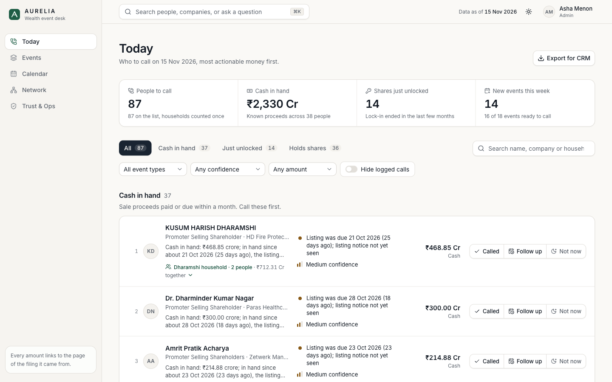
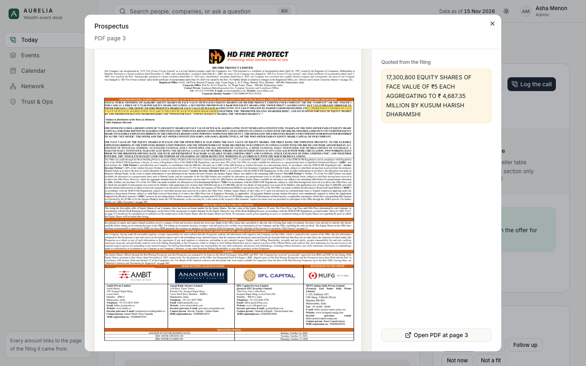
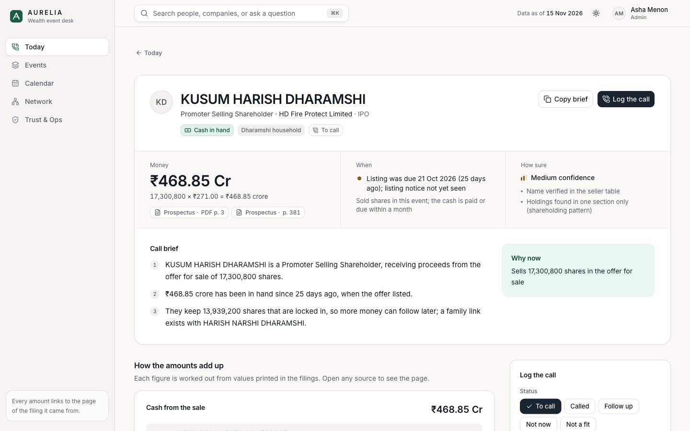
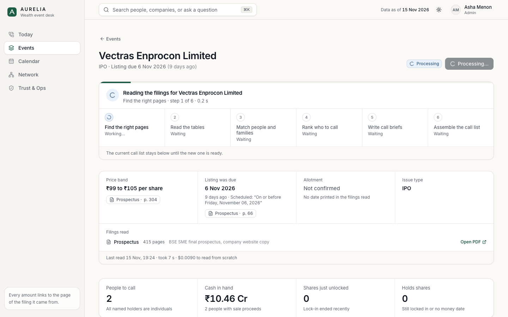
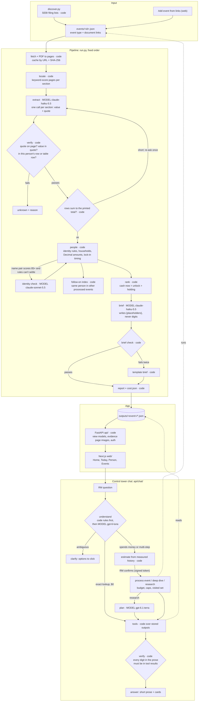

# AURELIA: money event → who an RM should call

When an Indian company lists, buys back shares, or a promoter sells through the exchange, named people come into money. AURELIA reads the public filings for that event and returns a **ranked call list**. Each person gets their name and role as printed, why they get money, a ₹ figure with its working, when the money arrives, how sure we are it's the right person, a link to the exact page behind every fact, and a 3–4 line brief to read before the call.

> **The rule everything is built around:** an invented number is the worst possible failure. A cheap model only *copies* text from a few pages. Code checks every quote against the page and does all the arithmetic. A value that fails the check is shown as **unknown, with the reason**, and is never guessed.

## Run the demo

```bash
./demo.sh start     # API on 127.0.0.1:8000, web on :3000 (PIDs in api/state/)
open http://localhost:3000
./demo.sh stop
```

**Sign in** with a demo account. The password is `demo1234` for all three, and they are also listed on the login page.

| Account | Role | Can |
| --- | --- | --- |
| `admin@aurelia.demo` | Admin | everything: process events, add events from links, Trust & Ops |
| `rm@aurelia.demo` | Relationship manager | view, ask, log calls and notes, export; process an event or add one from a link from chat after a confirm, up to $0.50 |
| `viewer@aurelia.demo` | Viewer | read only; free questions only |

Viewing costs nothing. Every processed event is stored in `outputs/`, and model answers replay from `cache/llm/` (both in git).

### Setup from a clean clone (under 10 minutes)

Needs Python 3.12 and a current Node (this was run with Python 3.12.13 and Node 26 on macOS).

```bash
python3 -m venv .venv
.venv/bin/pip install -r requirements.txt -r api/requirements.txt
(cd web && npm install)
cp .env.example .env        # optional: add LLM_API_KEY (OpenRouter) to process new events or chat with a model
./demo.sh start             # the first start also builds the web app
.venv/bin/python -m pytest -q   # 361 tests, about 15 s, no network and no key needed
```

Without a key, everything already processed works, including exact-lookup questions in the chat. Only new processing and model-written answers need `LLM_API_KEY`. `python -m tools.llm --ping` checks a key for a fraction of a cent.

**Filings are not in git.** The downloaded PDFs (`cache/fetch/`, `cache/pages/`) stay on the machine that fetched them. On a fresh clone, evidence links open the original filing at the right page; for the highlighted page images, re-run an event (`run.py --event events/<id>.json --step all`), which downloads its filings again while every model call replays from the cache at $0.

**Where data lives.** Pipeline outputs are files in `outputs/`. Users, call notes, chat history and RM preferences are in a database: SQLite at `api/state/app.sqlite`, or Postgres when `DATABASE_URL` is set (the Postgres path uses the same SQL; it was run against Postgres 17 behind PgBouncer in transaction mode, the way Neon's pooled URL works). The web app forwards `/api` to the API, which listens on the loopback address only.

### Deploy it

[docs/DEPLOYMENT.md](docs/DEPLOYMENT.md) is a step-by-step guide to put the demo online with the web app on **Vercel** (`sin1`), the API, pipeline and discovery on **Railway** (Singapore, Dockerfile at the repo root, a volume for `outputs/` and the caches), and the database on **Neon Postgres** (AWS Asia Pacific, Singapore). It covers every environment variable, first-boot data seeding, costs, a security checklist, a smoke test, troubleshooting and rollback. The local demo above needs none of it.

## What an RM sees

| Today: who to call, most actionable money first | Click any ₹ figure: the filing opens with the quote highlighted |
| --- | --- |
|  |  |
| **The call card: working, timing, confidence, brief** | **Processing a filing live: six steps, the old list kept until done** |
|  |  |

*The card shows ₹468.85 crore (17,300,800 × ₹271 offer price). The filing prints ₹4,687.35 million, slightly less; the card carries the caveat that employee-portion shares were sold at a discount, so actual proceeds are slightly lower.*

- **Home: the control tower.** One prompt box, the way ChatGPT or Claude works. Ask *"Who came into money this week?"* or *"What money does Manish Sharma have?"*. If a name is ambiguous, it asks back with options. Each answer shows its steps, with the model, cost and time of each one. Anything that would spend money shows an itemised estimate first, and runs only after you confirm.
- **Today:** the call queue in tiers: cash in hand → shares just unlocked → still holding. Households are grouped. One click logs a call.
- **Person:** a 2-minute call card, with the working behind each amount, timing, confidence, the brief, and every source.
- **Events:** each filing and who gets money from it. *Process now* re-reads an event live.
- **Calendar, Network, Trust & Ops:** money dates, family links, and checked-vs-rejected values with cost per event.

## How it works



### Every agent and step

| Step | File | Given | Returns | Runs on | What decides what runs next |
| --- | --- | --- | --- | --- | --- |
| Discover | `discover.py`, `tools/discover.py`, `config/sources.py` | SEBI filing lists and RSS (NSE and BSE are off by their terms) | `events/auto/<id>.json` per new money event | code; one cached `claude-haiku-5.5` call only for a title no rule can classify | Event type rules in `config/discovery.py`; `--max-cost` stops new runs |
| Event check | `agents/spec.py` | event JSON | validated spec | code | An unsupported event type stops here |
| Fetch + pages | `tools/fetch.py`, `tools/pdf.py` | document URLs | cached file; `[{pdf_index, printed_page, text}]` | code | No retry on 401/403; a cached copy younger than 7 days is reused |
| Locate | `agents/locate.py`, `config/sections.py` | all pages | top pages per section (sellers, holdings, average cost, price, timetable, …) | code | The event type's section list |
| Extract | `agents/extract.py`, `agents/extract_schemas.py` | 3–5 chosen pages for one section | rows and offer facts, each with a quote | `claude-haiku-5.5` | One call per section; **one retry** when verified rows sum below the printed total |
| Verify | `agents/verify.py`, `tools/tables.py` | proposed values and the page text | kept values; rejections with reasons | code | A failed value becomes "unknown" and nothing downstream may fill it |
| People | `agents/people.py`, `agents/rules_ipo.py`, `rules_buyback.py`, `rules_ofs.py`, `agents/rule_sources.py` | `extract.json` | `people.json`: identity, households, ₹ amounts with working, timing, confidence | code | Lock-in dates only when the rule is quoted from this event's own pages |
| Identity check | `agents/identity.py` | two names and their quotes | same / different / unsure | `claude-sonnet-5.5`, only for pairs scoring 85 or more that the code rules can't settle | "unsure" is flagged, never merged |
| Follow-on | `tools/people_index.py` | this event's people | `outputs/index.json` and matches per person | code | Only already-processed events, one level deep, at most 10 matches, no web search |
| Rank | `agents/rank.py`, `config/ranking.py` | `people.json` | `ranked.json`: call list, organisations, context | code | Tier first (cash now → unlock → holding), then known amount, then score |
| Brief | `agents/brief.py` | one person's verified fields | 3–4 lines | `claude-haiku-5.5` writes words and `{placeholders}`; code fills every number | Any digit outside a placeholder fails → one retry → template |
| Report + cost | `agents/report.py`, `tools/costs.py` | all outputs and the cost log | `report.md`, `cost.json` (per event and per person) | code | Last step |
| API | `api/main.py`, `api/views.py`, `api/evidence.py` | outputs, cached PDFs, database | RM view models, highlighted page images | code | Role check on every route |
| Chat: understand | `api/chat/router.py`, `api/chat/clarify.py` | the RM's message | intent and entities, or a clarify question | code rules first ($0); then `openai/gpt-6-luna` | Exact lookup → tools; ambiguous → clarify; multi-step or spending → estimate → confirm (research then plans) |
| Chat: plan | `api/chat/planner.py` | the question and the tool list | a JSON plan of at most 5 tool calls | `openai/gpt-6.1-terra` | Only after the RM confirms a multi-step estimate |
| Chat: tools | `api/chat/tools.py` | the plan or lookup | facts plus cards (the same view models as the screens) | code, $0 | — |
| Chat: estimate + confirm | `api/chat/estimate.py`, `api/chat/tokens.py` | a spending action | itemised steps, model, $ low–high, seconds; a signed token valid 10 min | code, from `cost_log.csv` and `runs.csv` history | Nothing spends without the token. Viewer: $0 only; RM: up to $0.50; admin: no cap |
| Chat: deep dive | `api/chat/deep_dive.py`, `api/chat/actions.py`, `config/chat.py` | one person | a lineage tree: same person elsewhere, family, related filings, optional new events | code (+ pipeline runs it confirmed) | Budget $0.25, caps per branch kind, depth 2, a visited set, most promising (₹ × recency) first |
| Chat: verify + answer | `api/chat/verifier.py`, `api/chat/writer.py` | draft prose and the tool results | prose where every number is in the tool data (others removed), plus cards | code; prose by `gpt-6-luna` (simple) or `gpt-6.1-terra` (multi-step research and confirmed deep dives) | — |

Every model call goes through `llm_call()` in `tools/llm.py`. It refuses a model with no price in `PRICES`, caches by model + prompt version + schema + messages, and logs tokens and cost to `cost_log.csv`.

## The events, and why these

| Event | Kind | Why it is here | People to call | Fresh cost (estimate) |
| --- | --- | --- | --- | --- |
| `sedemac_ipo` | IPO, main board | 23 selling shareholders with inconsistent printed names, promoter lock-ins, and a separate allotment notice for the final price | 19 | $0.029 |
| `spacenet_ofs` | Promoter sale through the exchange | No prospectus: only the company's notice to the exchanges (19 pages). Tests a different document shape and fast settlement | 3 | $0.005 |
| `vectras_ipo` | IPO, SME | SME lock-in rules differ from main board; a single prospectus | 2 | $0.009 |
| `garware_buyback` | Tender-offer buyback | Promoters who say they will *not* tender: the system must not list them as paid | 0 (14 in context) | $0.017 |
| `wipro_buyback` | Tender-offer buyback, promoters paid | The first buyback where promoters tender and cash is due. The letter of offer prints each promoter's maximum shares (table 7.1, pdf 22), the ₹250 price (pdf 6), the entitlement "10 for every 197" (pdf 1) and a last payment date of 24 Jun 2026 (pdf 5). Tests a pro-rata estimate, a payout in the past, and partnership firms that must not be merged into their partner | 4 (Azim H Premji ≈ ₹332.60 crore, Rishad Azim Premji ≈ ₹17.18 crore, Tariq Azim Premji ≈ ₹16.80 crore, Yasmeen A Premji ≈ ₹6.50 crore); 7 entities listed apart | $0.013 |
| 14 more from live discovery | IPOs and buybacks found on SEBI | Not chosen by hand: they show what happens on events nobody prepared for (2 are scanned images with no text layer) | 0–22 each | $0.002–$0.027 |

All of this is as of 15 Nov 2026, from `outputs/*/cost.json`. A **fresh** cost counts every model call as if nothing were cached. **Repeat runs** of the same documents cost **$0.000**, because every model call is a cache hit (e.g. SEDEMAC: 31 of 31 calls cached, 18.6 s). All development spend, across 2,022 logged model calls: **$0.46**, against a $2-per-event budget.

## Measured accuracy

Checked on 20 people from the call lists of 6 events (the top 3 by rank in each, plus one extra each for the two longest lists). The gold was read from the printed pages by an AI assistant, then checked mechanically: every quote is on its page and every amount equals shares × price. Run it with `python -m eval.check_people` (`--verify-gold` re-checks the gold itself).

| Field | Printed in the filing | Hit | Wrong | Missing | Hit rate |
| --- | --- | --- | --- | --- | --- |
| Name | 20 | 20 | 0 | 0 | 100% |
| Role | 20 | 16 | 0 | 4 | 80% |
| Shares offered | 10 | 10 | 0 | 0 | 100% |
| Shares held before the offer | 17 | 16 | 0 | 1 | 94% |
| Price | 20 | 17 | 0 | 3 | 85% |
| ₹ amount | 14 | 14 | 0 | 0 | 100% |
| Timing | 17 | 16 | 0 | 1 | 94% |
| **All value fields** | **118** | **109** | **0** | **9** | **92%** |

- **Wrong: 0. Invented: 0.** All 9 misses are fields where the system said "unknown" (3 of the 4 role misses and all 3 price misses come from one buyback, FDC). The 22 fields the documents leave blank (for example per-seller amounts in the Spacenet notice) were all left unknown. 15 of 20 people have every field right.
- **Per event:** SEDEMAC 25/25, Tonbo 21/21, Spacenet 12/12, SFC 27/28, HD Fire 18/20, FDC buyback 6/12.
- **Limits:** the 20 people come from the system's own call lists, so this measures whether the people it called are right, not whether it missed anyone. Top-ranked people are probably easier. The gold was read by an AI assistant and checked mechanically, not by a human analyst. Two picks the rule skipped (Tonbo rank 8, HD Fire rank 5) look like misses and are named in the gold file, so the number is not flattering by omission.

What it gets wrong, with real examples, is in [whats_broken.md](whats_broken.md).

## Running a new event

1. Paste filing links into **Events → Add event from links**, or ask in the chat (*"Process a new IPO from a link"*). Both show the cost first. Or write `events/<event_id>.json` yourself:

   ```json
   {
     "event_id": "example_buyback",
     "event_type": "buyback",
     "company": "Example Limited",
     "documents": [
       {"url": "https://.../letter-of-offer.pdf", "doc_type": "letter_of_offer", "note": "optional"}
     ]
   }
   ```

   - `event_type`: `ipo`, `buyback` or `ofs_stock_exchange` have rules (`config/event_types.py`).
   - `doc_type`: `rhp`, `prospectus`, `letter_of_offer`, `announcement` or `news`. For an IPO, an `announcement` (basis of allotment) is read whole for the final price and dates.
   - Public documents only. Nothing behind a login, and no 401/403 is retried.

2. Run every step:

   ```bash
   .venv/bin/python run.py --event events/<event_id>.json --step all
   ```

   It prints a timeline (seconds, model calls, cost per step) and writes `outputs/<event_id>/`: `locate`, `extract`, `people`, `ranked`, `briefs`, `cost`, `timeline` and `report.md`.

**Live discovery:** `python discover.py --since 30d [--process N] [--max-cost 2.00]` finds new money events on SEBI's public filing lists and writes `events/auto/<id>.json`. NSE and BSE feeds are listed but switched off, each with the sentence from its terms that forbids automated collection (`config/sources.py`).

## More

- [docs/part_a.md](docs/part_a.md): how the reference product probably works
- [docs/DEPLOYMENT.md](docs/DEPLOYMENT.md): deploy to Vercel + Railway + Neon, all in Singapore
- [docs/live_run_rehearsal.md](docs/live_run_rehearsal.md): a fresh event run live, step by step, with measured time and cost
- [docs/what_if.md](docs/what_if.md): what changes at 500 events a week, and the measured cost per run
- [api/CHAT_CONTRACT.md](api/CHAT_CONTRACT.md): the control-tower chat contract (memory, time windows, call scripts, caching, streaming, exports)
- [docs/part_c.md](docs/part_c.md) ([PDF](docs/part_c.pdf)): first meeting, demo, pilot, compliance
- [decision_log.md](decision_log.md): 14 decisions, with the options and what would change them
- [assumptions.md](assumptions.md): how each ambiguity in the brief was read
- [whats_broken.md](whats_broken.md): real wrong answers and the two-week plan
- [docs/video_script.md](docs/video_script.md): the 10-minute walkthrough
- `cost_log.csv` (every model call) and `outputs/runs.csv` (every run)
