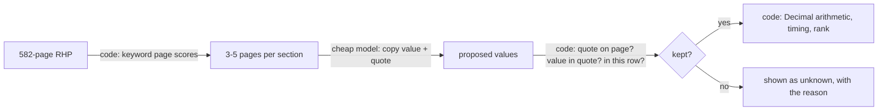

# Decision log

Real decisions from building this, in the order they were made. Each cites the commit or date where it landed, so you can check the code it produced. The numbers come from `cost_log.csv`, `outputs/runs.csv` and `outputs/*/` as of 15 Nov 2026.

> **The one rule behind most rows:** the model copies text; code does everything that has a right answer (finding pages, checking quotes, arithmetic, ranking). That splits the work so that the expensive, unreliable part is small and checkable.

| # | Decision | Options you considered | What you chose and why | What would make you change it |
| --- | --- | --- | --- | --- |
| 1 | **How to orchestrate the agents** | (a) LangGraph or CrewAI; (b) one tool-using agent with web search; (c) plain Python: a fixed step order in `run.py` | **(c), from day 1** (`f45c11b`, 13 Nov; written down as a hard rule in `31e1220`). A framework would give me graph state, retries, tracing and tool calling. But my hard parts are finding pages, checking quotes and arithmetic, and a framework helps with none of those. The step order never changes: `STEPS = ("locate", "extract", "people", "rank", "brief", "report")` in `run.py`, with verify inside extract. The whole "orchestrator" is a loop over that tuple (`_run_all`, about 20 lines), and I can explain every line. Retries and the cost log live in one function, `llm_call()`. | If the flow became truly dynamic (many tools, chosen per question), a framework's tracing could pay for itself. The chat control tower is that case, and it is still plain code for now: a fixed loop of understand → clarify → plan → tools → verify → answer |
| 2 | **One big agent per event, or narrow extractors** | (a) one model reads the whole offer document and returns everyone; (b) one agent per person; (c) one small call per document section, each with a fixed JSON schema | **(c): about 10 narrow calls per event**, e.g. selling shareholders, promoter holding, shareholding pattern, average cost, price, timetable (`agents/extract.py`, `config/sections.py`). SEDEMAC's RHP is 582 pages, about 483,000 tokens (characters ÷ 4, an estimate). All of my extract calls together send about 122,000 tokens at most, and each section is cached on its own. Narrow outputs are also checkable: each value comes with a quote from 3–5 known pages, not from 582. | A new event type whose facts are spread across many sections (e.g. a merger scheme). Then one call per section gets expensive, and I'd add a second-pass "read this page too" step |
| 3 | **Who finds the right pages** | (a) the model reads all pages and picks; (b) embeddings and semantic search; (c) keyword scores in code | **(c)** (`agents/locate.py`, 13 Nov). Offer documents use fixed SEBI headings ("Selling Shareholders", "Shareholding Pattern"), so keywords work, cost $0 and are explainable. Measured on hand-marked SEDEMAC pages: right page in the top 3 for 2 of 3 sections (offer structure misses). | A hit rate below about 80% on new events, or subsidiaries' tables outranking the issuer's own (it happened at Zetwerk, see `whats_broken.md`). Then: keyword pre-filter plus a cheap model rerank of the top 10 |
| 4 | **Who decides a value is true** | (a) trust the model's JSON; (b) ask a second model to check; (c) code checks every quote against the page text | **(c)** (`agents/verify.py`). A value is kept only if its quote is on the cited page, the value is inside the quote, and the quote sits in that person's row. Anything else becomes "unknown" with the reason shown. A model checking a model fails the same way twice. Since 15 Nov (`be58a2f`), a value the text check rejects can also be kept when the page's ruled table has a row with this exact name and this value. Rejections across all events: **115 → 82**; "not in this person's row": **22 → 4**. | Proof that the check passes wrong values often. Today it can pass a value from the wrong column of the right row (reproduced on a synthetic table). Next step: bind each value to a table cell and its column header |
| 5 | **Who does the arithmetic** | (a) the model computes proceeds; (b) code computes with floats; (c) code computes with `Decimal` and prints the working | **(c)**. shares × price, gain over average cost, and retained value, all in `agents/rules_*.py`. Every ₹ figure on screen shows its working, e.g. *17,300,800 × ₹271.00 = ₹468.85 crore*. A model doing sums is the easiest way to invent a number. | Nothing. This one is not up for trade |
| 6 | **Which model where** | (a) one strong model for everything; (b) one cheap model for everything; (c) cheap by default, strong only for hard cases | **(c)**. `claude-haiku-5.5` ($0.10 / $0.50 per 1M tokens) copies text and writes briefs. `claude-sonnet-5.5` ($2 / $10) is called only when two holder names score 85 or more on fuzzy match and the code rules cannot settle them (`agents/identity.py`, 14 Nov). A real case from Tonbo: "CEAQ TECHNOLOGIES PRIVATE LIMITED" vs "CEAQ TECHNOLOGIES PTE. LTD." scores 93.5, and the model answered *different* (an Indian company vs a Singapore one). Result: 73 strong-model calls out of 2,022, costing **$0.029 of $0.458 total**. | If the cheap model's quote rejections grew past about 30%, I'd retry a failed section once with the strong model rather than switch everything |
| 7 | **How repeat runs get cheaper** | (a) no cache; (b) cache whole runs; (c) cache each download and each model call by content | **(c)**. Downloads are keyed by URL, with the body's SHA-256 kept, so a changed filing is noticed and the old copy archived (`tools/fetch.py`). Model calls are keyed by model + prompt version + schema + exact messages (`tools/llm.py`), so a rerun of the same pages costs $0. SEDEMAC: fresh about **$0.029 → rerun $0.000** (all 31 calls cached, 18.6 s, 14 Nov). | Filings that change silently under the same URL. Then the 7-day freshness window should drop for documents still in their offer period |
| 8 | **Where discovery may look** | (a) NSE and BSE RSS feeds; (b) news scraping; (c) SEBI's public filing lists only | **(c)** (`config/sources.py`, `ffa04c9`, 15 Nov). NSE's terms forbid "any systematic or automated data collection", and BSE's forbid reproduction. SEBI's policy allows linking. The line I draw: no automated reading of NSE or BSE, but a single exchange PDF can be added by hand as an event document (SEDEMAC's basis of allotment and the Spacenet OFS notice are `nsearchives.nseindia.com` links). | A licensed exchange data feed. It is the biggest coverage gain (OFS results, bulk deals) and would replace the hand-added links. **Superseded by row 15:** I chose to read NSE and BSE too, with guardrails |
| 9 | **Who writes the digits in the RM brief** | (a) the model writes the brief and code checks that each number appears somewhere in the person's fields; (b) a fixed template; (c) the model writes `{placeholders}` and code fills every number | **(c)** (`2c253da`, 15 Nov). (a) passed *"retained 42,000 shares"*. 42,000 was his pre-offer holding; he kept 29,400. Now any digit outside a placeholder fails, then one retry, then the template. The same brief now reads *"They keep at least 29,400 shares"*. | If briefs read badly after filling (it happens: "in hand since in hand since"), the model could choose sentence frames, but still never the digits |
| 10 | **How to order the call list** | (a) by wealth (largest holding first); (b) one score = money × confidence; (c) tiers by timing first: cash now → just unlocked → still holding, then amount | **(c)** (`2c253da`). An RM's question is "why call *today*". Cash now means proceeds paid or due within 30 days. Unknown amounts sort below known ones, and unknown timing is weighted below every known timing. Before: SEDEMAC's founder, with ₹966.75 crore of just-unlocked stock, ranked **#18 of 19**. After: **#1**. | The Head of RMs telling us their RMs only pitch on cash received, not paper wealth. Then "just unlocked" moves to a watch list |
| 11 | **Lock-in rules: hard-code SEBI's, or read them from the filing** | (a) hard-code the current SEBI lock-in periods; (b) read the periods from the event's own pages | **(b)** (`agents/rule_sources.py`, `config/lock_in.py`, 14 Nov). Periods differ for SME and main board, and changed over time. A date is used only when its rule is quoted from this document, otherwise timing says "not stated in this event's documents". Number words and variants were added on 15 Nov (`be58a2f`); the promoter lock-in is now found in BLS, Jio, Paras, Tonbo, Crystal, SFC and HD Fire. | Column-split pages, where the words of the rule interleave, defeat word matching. That pushes toward reading the printed lock-in table instead |
| 12 | **Who is on the call list** | (a) everyone in the seller and holder tables; (b) people and family vehicles only, with funds and companies kept separate; (c) individuals only | **(b)** (`config/ranking.py`, `config/holder_types.py`). An RM cannot call a fund. HUFs and family trusts stay on the list, because the RM calls the family. Funds and companies go to an "organisations" list, as later work (the people behind them). Families are grouped by printed names into households and flagged, never merged. | Relationship lines printed in the filing ("wife of", "trustee"). They would give harder household links than surname matching |
| 13 | **What the RM uses** | (a) keep Streamlit and polish it; (b) Next.js + FastAPI over the same pipeline outputs; (c) a full product rebuild with Postgres and job workers | **(b)** (`50e2d28`, 15 Nov). Streamlit ran the pipeline inside the page, so a click could lose a live run, and it could not hold sign-in or per-RM call notes. (b) reuses every output file as it is; only users and call notes go to a database (SQLite, or Postgres when `DATABASE_URL` is set). (c) is weeks of work before any RM feedback. | A pilot with more than about 10 RMs, or the firm needing SSO and an audit trail. Then (c) |
| 14 | **The chat control tower: models and spending** | (a) Claude models for chat too; (b) ChatGPT models through the same OpenRouter key; and for spending: (i) run whatever is asked, (ii) show an itemised estimate and wait for a confirm | **(b) + (ii)** (design `525e2ec`, 15 Nov). `openai/gpt-6-luna` routes and asks clarifying questions, and `openai/gpt-6.1-terra` plans multi-step questions. Exact lookups use code rules and cost $0. The pipeline stays on Haiku, because switching its model would invalidate the cache, and every repeat run would cost again. Anything that spends (process an event, a deep dive) first shows steps, models, $ low–high and seconds, from measured history. Nothing runs without the RM's confirm. | Real usage showing the estimates are off by more than 2×. Or the firm wanting one model vendor for data-protection reasons |
| 15 | **Read NSE and BSE despite their terms** | (a) keep SEBI only (row 8) and add exchange PDFs by hand; (b) read NSE and BSE with a polite, disclosed client; (c) buy a licensed exchange data feed | **(b)**, my call after being told the risk (design `05f6bd2`; discovery `37ead96`). It goes against NSE's terms ("any systematic or automated data collection") and BSE's ("reproduction, redistribution"), and against the brief's own ground rule about such sites. I took it because the biggest coverage gaps are exchange-only: allotment and listing notices, OFS notices, block and bulk deals, promoter and insider sales. Guardrails, not negotiable: at least 2 s between requests to a site, every response cached, only new items fetched, an honest User-Agent naming the app, ordinary session cookies from a home-page visit, no proxies, no IP rotation, no CAPTCHA solving, and a 401, 403 or 429 stops that source for the run and shows it as "blocked". One switch, `EXCHANGE_SOURCES=on\|off`. The Sources page labels both exchanges "High risk" and links their terms. Risk: the sites can block us, and the firm carries the terms risk if this ran in production; from cloud servers NSE will likely refuse anyway (`docs/DEPLOYMENT.md`). | A complaint or a block from either exchange, or the firm deciding the terms risk is not acceptable: then `EXCHANGE_SOURCES=off` and (c) |
| 16 | **Process new signals automatically, or only on request** | (a) only when an admin presses process; (b) process everything discovered; (c) process automatically under a daily spend cap, with anything over the cap waiting for approval | **(c)** (`37ead96`, `dc04891`). Discovery runs every 3 hours inside the API (`DISCOVERY_EVERY_HOURS`), then new events are processed oldest first while today's automatic spend stays under `AUTO_PROCESS_DAILY_CAP_USD` (default $1.00, counted per India day from `cost_log.csv` rows whose run id starts with `auto-`). Before each run the event's estimate, its costliest comparable run so far, must fit in what is left, so a run is never started that is expected to cross the cap; what does not fit shows as "Needs approval". "Check for new filings now" (admin) shows an estimate first, runs only on Confirm with a single-use token, and never spends past the confirmed ceiling. A lock file keeps it to one runner per machine. Why: at about $0.002–$0.03 per new event, $1 a day covers a normal day's filings, and an RM sees a new call list without anyone pressing a button. Risk: a run that costs more than every run before it can overshoot the cap by that difference, after which nothing more starts that day. | Daily spend near the cap on most days (raise it, or narrow the sources), or a run that overshoots by more than a few cents (then add a hard per-run budget inside `run.py`) |
