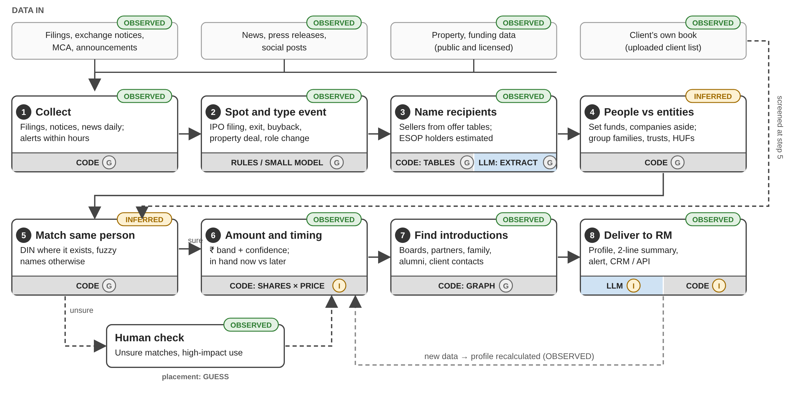

# Part A: How Affluense probably works

The product is behind a login; the public site is marketing [O, S1]. Sources: Affluense's pages, a CEO interview, SEBI and MCA rules, and one IPO offer document I read (S18, cover and pp. 2–20). Links in `sources.md`.

## 1. The pipeline

*Badge: does the step exist? Strip: what runs it. Both use the labels in section 2. Evidence for each step:*

| Step | Public evidence | My read |
| --- | --- | --- |
| Sources | Filings, exchange notices, announcements [O, S13]; news, MCA, social, "250+ sources" [O, S2, S14]; "public and licensed", incl. property and funding databases [O, S1] | If licensed, coverage rides on vendor contracts, and a public-only build like mine sees fewer private events [I, from S1]. |
| 1–2 Collect, spot | Ingested daily; alerts within hours, on IPO filings, exits, property deals, role changes [O, S1] | Rules or a small classifier [G]. |
| 3 Recipients | Events linked to beneficiaries [O, S2]; ESOP beneficiaries estimated from tenure, seniority, funding rounds, ESOP-trust records [O, S14] | For filings, code pulls the seller and shareholding tables and an LLM sees only that extract, not 300+ pages [G]. |
| 4 People vs entities | Not disclosed; the graph uses family ties [O, S1] | The data forces it: 13 of SEDEMAC's 23 sellers are entities [I, from S18]. |
| 5 Match | Client lists screened against the database [O, S1] | DIN where it exists [O, S20], fuzzy names otherwise [G]. |
| Human check | Human review for high-impact use [O, S4] | On unsure matches, where a wrong name embarrasses an RM [G]. |
| 6 Amount, timing | Band + confidence from holdings, property, valuations [O, S1]; ESOP amounts from seniority, tenure, pool, buyback % [O, S14]; net worth never verified [O, S13] | Shares × price is arithmetic, so code [I]. No public sign of an in-hand vs later split [G]. |
| 7–8 Intros, deliver | Client's and colleagues' contacts [O, S13]; boards, partners, family [O, S1]; LinkedIn mutuals, alumni [O, S14]; "AI" two-line summaries [O, S3]; CRM, API, recalculation on new data [O, S1]; mobile and email [O, S14] | LLM for summaries, code for the rest [I, from S3, S4]. LinkedIn and client-held contacts raise consent and terms questions that filings don't [I]. |

## 2. Claim labels

**[O]** the linked source says it. **[I]** it follows from an [O]; the basis is stated. **[G]** a guess. A step that is described but whose implementation isn't is [O] for the step and [G] for the how. Affluense's own claims are [O] only that they *say* it, not that it's true. Claims about Indian filings are [O] only where checked in S18.

## 3. The three hard parts

**1. Knowing who got paid, early enough to matter.**

*Why it's hard.* Speed and certainty pull in opposite directions, and the client's complaint ("a month late") sits exactly there. Affluense alerts on the IPO *filing* [O, S1], but even the RHP shows the price as ₹[●] [O, S18]; names and amounts firm up only as the documents do [I]. Private events are worse: ESOP buybacks are announced as a total and a headcount [O, S14, S17], and MCA filings show an ESOP trust, not employees [O, S14].

*What the RHP shows.* For IPOs the list exists, but most of it isn't callable. SEDEMAC is a 100% offer for sale [O, S18]; where an IPO also has a fresh issue, that money goes to the company, so being on the cap table isn't being paid [G: no mixed issue checked]. 13 of 23 sellers are funds, companies, trusts, a society or an HUF, and eight of the ten individuals appear only in the full list, not on the cover [O, S18 cover, pp. 16–17]. Employees are the blank: the RHP lists two ESOP schemes with no per-person detail in the pages read [O, S18 p. 18], and offer documents usually name only key managers' grants [G]. Those stay blank, not invented.

*How they handle it.* Early and estimated: alerts on filing [O, S1], beneficiaries estimated from tenure and seniority [O, S14]. The ESOP page promises "de-anonymization", while its FAQ and the methodology page say receipt isn't proven [O, S13, S14]. The output is people *likely* paid, marketed as people who were [I].

**2. Knowing it's the same person, and the same family.**

*Why it's hard.* A wrong merge attaches someone else's money to the person the RM calls. A DIN exists only for directors and designated partners [O, S20], and ESOP holders found through employment data share no identifier with filings [I, from S14].

*What the RHP shows.* Middle names link relatives: sellers "Atul Hiralal Shah" and "Bakul Hiralal Shah"; promoter group "Ashwini Amit Dixit" and "Priyanka Manish Sharma" beside promoters Amit Arun Dixit and Manish Sharma [O, S18 pp. 16–18]. That maps families but breaks initials: "A. H. Shah" fits both sellers [I]. A family trust appears only through its trustee company [O, S18 p. 17]. Ungrouped, one family reads as several small sellers [I].

*How they handle it.* Not disclosed. The graph uses family ties [O, S1]; likely DIN as the anchor, fuzzy matching otherwise, unsure matches flagged for a human rather than merged [G].

**3. Amount, timing and confidence, kept apart.**

*Why it's hard.* One estimate (how much) sits on another (who), so errors compound [I]. Net worth needs debt and pledges, which these filings don't show [G].

*What the RHP shows.* Each seller's average cost is disclosed (₹46 a share for promoter seller Manish Sharma, ₹368 for A91 Emerging Fund II) [O, S18 cover], so the gain and its tax can be estimated, not just proceeds [I]. The MD holds 16.16% and isn't selling [O, S18 p. 18]: the biggest wealth here isn't in motion. Timing splits three ways. Offer-for-sale proceeds arrive at listing [I]. Non-promoter pre-IPO shares are locked for six months and the promoters' minimum contribution for 18 [O, S18 p. 8, S19]. Qualifying pre-IPO ESOP shares are exempt from that lock-in [O, S21], so employees who have already exercised can sell at listing [I]. One ₹ figure per person is wrong: it needs *in hand now* and *arriving later*, kept apart from match confidence [I].

*How they handle it.* Bands with a confidence flag [O, S1]; ESOP amounts from seniority, tenure, pool size and buyback % [O, S14]. No public sign of a timing field [G].

## 4. The business

**Who buys.** Named customers include Nuvama, Neo Group, Angel One [O, S3] and Kristal.ai [O, S1]. The CEO says "around 25 wealth firms" are live [O, S2]; the site claims 150+ "wealth management teams" [O, S1]. Either "teams" counts desks inside firms, or the 150 includes the family offices and luxury brands the site also targets [O, S1]. Either way, the wealth-firm base is smaller than the headline [I]. The three testimonials are from two CTOs and a digital-transformation business analyst [O, S1], hinting at a technology-side champion [G: marketing picks the quotes]. The CEO pitches leadership on keeping client knowledge when RMs leave [O, S2], so the budget likely sits with business leadership [I]. No public pricing, only a demo and an ROI calculator [O, S1]: value-based pricing [G].

**Who uses it, and what they do with it.** RMs [O, S13]. Affluense's own guidance treats an event as a reason to research, not to dial [O, S13], and claims beneficiaries pick an adviser within 30–60 days [O that they claim it, S14]. So an RM's first minute is four questions: is the money in hand or locked; is it above our minimum; is this definitely the right person; is there a warm path. The first and third decide whether the call is this week [I].

**What I'd copy, and why it works**

- **Event-first, not database-first** [O, S2, S14]. An event says why to call this month, which is what the client asked for.
- **Ranges with a confidence flag** [O, S1]. An RM quoting a range is wrong less often.
- **Screening the client's own book** against new events [O, S1, S2]. Cheap, and it finds the warmest leads.

**What I'd do differently, and why**

- **A source link on every figure,** so the RM can defend it and compliance can audit it.
- **"Documented" or "estimated" on every name and amount, on screen.** Their blog draws this line [O, S13]; the RM never reads the blog.
- **Timing and gain as fields:** in hand or locked until a date; proceeds versus cost [I, from S18, S19, S21].
- **People ranked apart from funds,** with families grouped (hard parts 1–2).
- **A warm path instead of a phone number.** Contacts lag [O, S14] and are the riskiest data to hold under India's data-protection law (Part C). A board, co-investor or client-book link makes a better first call. RMs may still want the number; I'd test that with the Head of RMs.
- **Measure event-to-RM time,** the client's actual complaint.
